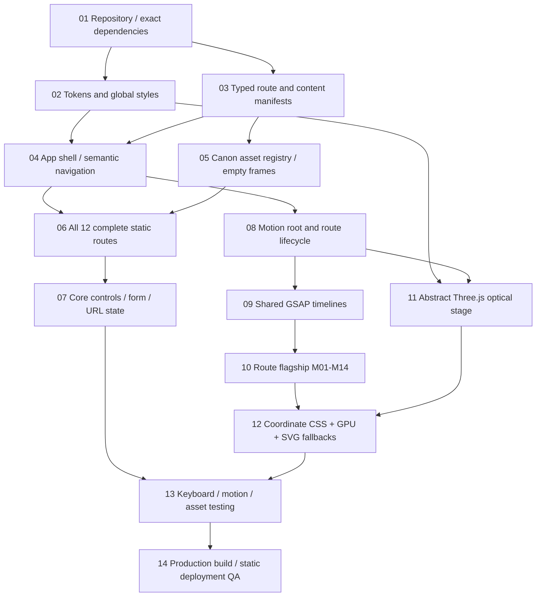

# SUNNY STARSCOUT — THE OPEN-HOOF ATLAS
## Product Requirements Document · Experimental In-Universe Portfolio

> **IMPLEMENTATION CONTRACT — ARENA.AI BATTLE MODE / CODE.** Build the complete website described here; do not replace the specified experience with a one-page mockup, substitute invented pony art, or reduce the flagship motion system to generic fades. This document is the final source of truth for website requirements. This is a specification, **not** a request to produce this document again.

| Field | Final decision |
|---|---|
| Working website name | **The Open-Hoof Atlas** |
| Owner / narrator | Sunny Starscout, in first person |
| Website language | English, exclusively |
| Experience | Cinematic, accessible, editorial multi-page portfolio |
| Routes | 12 content routes plus not-found view |
| Case studies | Six specific, canon-grounded collaborative/community projects |
| Primary stack | React + TypeScript + Vite + React Router + GSAP/ScrollTrigger + Three.js |
| Storage | Client-side only for user settings and letter draft |
| Hosting | Static files on Cloudflare Pages or GitHub Pages |
| Canon visuals | **Zero bundled canon images. All slots begin empty, intentionally.** |
| Core test | Exceptional art direction **and** complete, reliable functionality |
| Source research | Conducted 9 November 2026; full bibliography at end |

---

# 01. Read This First — Authority, Invariants, Deliverables

## 01.1 Binding directives

- `META-001`: Deliver a functioning production-buildable React app, not a flat screenshot or design-only prototype.
- `META-002`: All `/`, `/work`, six project routes, `/journey`, `/journal`, `/about`, and `/connect` MUST be functional and content-complete.
- `META-003`: A user lacking any canon artwork must still see a premium, composed, readable website, not broken images.
- `META-004`: **Do not invent, generate, approximate, draw, or substitute any canon-dependent visual asset. Use the specified empty aesthetic placeholder. No exceptions.**
- `META-005`: Every written string exposed to visitors is the English copy prescribed below. Do not silently create promotional copy, fake testimonials, numbers, awards, dates, product claims, or fabricated dialogue.
- `META-006`: The experimental motion system is integral, not optional decoration. Implement all specified flagship sequences, including their adaptive and reduced-motion equivalents.
- `META-007`: The server is not required for routing, any core interactivity, or the contact flow. No fake message submission.
- `META-008`: Visually distinct routes, semantic HTML, keyboard operation, visible focus, and readable static fallbacks are mandatory.
- `META-009`: Critical rules in this document outrank design improvisation, dependency defaults, and accidental tool suggestions.
- `META-010`: When a conflict arises: canon integrity > in-universe truth > functionality > exact content/layout > flagship motion > adaptive performance > minor invention.

## 01.2 Deliverable definition

The coding agent must return a Vite project with `package.json`, a pinned lockfile, semantic components, route-specific pages, local content/asset manifests, CSS tokens, GLSL shader files (where needed), unit tests, browser acceptance tests, documentation, and static deployment configuration. `npm install`, `npm run dev`, `npm run build`, and `npm run preview` must work. The project must not require an API key, server database, CDN scripts, random image service, or paid account at runtime.

## 01.3 Why this specification is unusually strict

This is a **one-shot model-comparison stress test**. A weaker model can often produce a convincing first viewport while leaving six pages inert, replacing a missing character with a generic pony illustration, or calling one fade-in a cinematic experience. Such shortcuts are explicit failures. A sophisticated model may independently verify APIs but may **not** redesign this contract. GitHub Spec Kit's specification-first guidance informs the ID-to-test approach, not a required dependency ([T01]).

## 01.4 Evidence status legend

| Label | Meaning | UI use |
|---|---|---|
| `C` Confirmed | Event/activity explicitly substantiated by primary synopsis or named episode/transcript | May be claimed in Sunny's voice |
| `S` Secondary-supported | Detailed community episode guide/transcript, no independent official narrative verified | May be used conservatively; avoid exact metrics |
| `I` In-universe inference | Plausible diary/project framing, but not a separately established event | Phrase as interpretation or personal reflection, not new accomplishment |
| `D` Design fiction | Interface metaphor, layout, editorial naming, placeholder treatment | Decorative/navigational only, never lore proof |
| `X` Forbidden | Contradiction, invented recognition/ownership, fake character/location/object | Never render |

**Research boundary:** product-site color values are art-direction approximations drawn from known Sunny visual traits, **not official sampled franchise HEX specifications**. A case-study title is an editorial heading, not necessarily the name of an in-world event. Canon credits and episode references live only in the PRD; visitors never see franchise media/production information.

---

# 02. Product Vision & Success Definition

## 02.1 Positioning

The Open-Hoof Atlas feels like the personal collection of field notes, community experiments, and travel memories belonging to Sunny Starscout of Maretime Bay. The design language is **a warm civic field-journal colliding with refracted light**: tactile peach paper, ink-blue annotations, handwritten-like marginalia, sudden kinetic type, and luminous nonfigurative optical fields. The soul of the website is not a heroic royal biography. It is a working pony who sold smoothies, changed minds, sometimes misjudged a situation, learned to ask for help, and believes every kind of creature deserves to belong.

## 02.2 Visitor questions

1. What does Sunny actually do? Community-building, smoothies, friendship advocacy, organizing, and listening.
2. What impact can be shown without false metrics? Participation, a reopened space, new relationships, visible shared effort, or a changed perspective.
3. What work is truly hers and what belongs to her friends? Each case includes a candid collaboration credit.
4. How did her thinking evolve? The journey and journal contrast conviction with humility and learning.
5. How can a visitor respond? Write and copy/download a message **locally**, with explicit no-delivery disclosure.

## 02.3 North-star quality outcomes

| Goal | Observable quality gate |
|---|---|
| G1. In-universe believability | Zero franchise/episode/actor/brand language in visitor-rendered DOM |
| G2. Factual restraint | All six projects have citations **in this PRD**, no invented quantitative outcomes in UI |
| G3. Multi-page | 12 unique content routes, six genuinely different case-study presentations |
| G4. Cinematic identity | 14 flagship sequences, with specified triggers, controls, and cleanup |
| G5. Missing-assets integrity | Removing every `/assets/canon/` file preserves every route/layout |
| G6. Robust interactivity | Every action changes state, navigates, copies, or downloads; no dummy CTA |
| G7. Adaptive design | Four viewport bands, three rendering tiers plus reduced-motion override |
| G8. Release evidence | Build, route sweep, keyboard sweep, motion smoke, GPU-loss test, source audit |

## 02.4 Non-goals

No wiki, episode index, toy store, social follower count, real mail server, payments, user accounts, live Equestrian network, exact geographic map, canon 3D reconstruction, or invented character artwork. The absence of these is intentional; the site is still a complete portfolio.

---

# 03. Research Dossier — Canon and Design Evidence

## 03.1 Canon chronology without fabricated dates

| Sequence | Canon-supported observation | Evidence | Implication |
|---|---|---|---|
| Earlier life | Argyle Starshine encouraged Sunny's belief that pony kinds were friends in the past | [C01], [C04] | About page presents family inspiration without claiming a precise year or cause of death |
| Restoration journey | Sunny and Izzy travel, encounter Pipp, Zipp and Hitch; group actions help restore magic through friendship | [C01], [C02], [C03] | Restoration case MUST not credit Sunny alone |
| Rebuilding | Friends make the Crystal Brighthouse home after Sunny's former lighthouse is lost | [C05] | Home is described as shared, not a project Sunny designed single-handedly |
| Maretime Bay Day | Sunny and friends navigate inclusion/conflict; she saves endangered ponies when magic destabilizes | [C06] | Festival becomes editorial reflection, not imaginary flawless campaign |
| Flora magic | The community garden opens, with Sunny welcoming residents and Hitch explaining flora magic | [C07], [C08] | Garden project is specific and defensible |
| Dahlia | Sunny helps a florist adapt to Earth Pony magic, causes unintended disruption, then finds a route forward with Pipp | [C09] | Case explicitly contains misstep and repair |
| Cleanup | Friends begin a town clean-up and traffic work; citizens join, including Posey; Sunny starts Cleanup Carnival | [C10] | Credit community and Posey's involvement |
| Equestria Games | Sunny organizes the first new inter-kind games, where competition becomes too intense | [C11] | Do not claim lasting harmonious outcome or medal totals |
| Shared winter traditions | Sunny tries to visit friends' traditions and return for Wishing Star; group solves weather issue | [C12] | Travel project celebrates listening and collaborative adaptation |

**Timeline rule:** order these story arcs relatively (Before / The Journey / Making Space / Learning Together / Continuing), not by invented in-world calendar dates. The exact relationship between episodic shorts is not perfectly specified. Never stamp arbitrary months/years in website UI.

## 03.2 Character guardrails

| Dimension | Required depiction | Forbidden exaggeration |
|---|---|---|
| Origin | Orange Earth Pony from Maretime Bay; later has an Alicorn transformation | Born a princess; always an Alicorn; leader of all Equestria |
| Work | Smoothie-maker and local community member | Royal CEO, paid diplomat, professional event agency |
| Motive | Connection, empathy, hope grounded in action | Eternal perfection, self-congratulation, magic as exclusive personal merit |
| Family | Argyle's remembered encouragement and lantern | Invented family documents, precise personal chronology |
| Friends | Izzy, Hitch, Pipp, Zipp; Misty may be mentioned only where canonically justified | Attributing a friend's work to Sunny |
| Magic | Connection is essential; Sunny has temporary/triggered magical transformation | Permanent status, fabricated rules for powers |
| Flaws | Overenthusiasm, impatience, lessons from mistakes | Flawless strategist, unbroken string of triumphs |
| Geography | Maretime Bay, Bridlewood, Zephyr Heights | Invented coordinates, distances, buildings, travel times |

## 03.3 Project selection and ethical crediting

Exactly six featured studies are required. Their focus is **how Sunny participated**, not how she allegedly owned a large organizational program. Copy must never imply: restoration was a solo mission; garden belonged exclusively to Sunny; Dahlia's commercial recovery was Sunny's product launch; the games ended without tension; the cleanup was completed by the Mane 5 alone; or that Sunny created the Marestream vehicle. The site may use a printed-journal-style organizational taxonomy (`Field Study`, `Working Notes`, `Outcome`) as a presentation device, clearly not a canonical organization.

## 03.4 Voice analysis from actual dialogue

Sunny's recognizable traits across [C03], [C07], [C09], [C12]: (a) eager introductions and concrete invitations; (b) asks others to join, rather than boasting; (c) sometimes speaks quickly and corrects herself; (d) uses ordinary objects and local projects to explain friendship; (e) faces embarrassment and tries to repair it; (f) enjoys low-key enthusiasm and candid admissions. This analysis is based on dialogue patterns; **all website text in this PRD is newly written** and must not be confused with canonical quotations.

### Voice rules (`COPY-001`)

- Default: first-person singular `I` when describing intention, `we` when describing shared results.
- Warmth level 8/10; humor 3/10; sentimentality 4/10; specificity 9/10; heroic self-praise 0/10.
- Sentence rhythm: alternate one short independent statement with one natural explanatory sentence; average roughly 9–18 words.
- Ask questions when genuinely inviting involvement: `What would help everypony feel welcome?`, not marketing slogans.
- Use visual observations and honest self-corrections. Permit `I got that wrong.` Avoid `revolutionary`, `game-changing`, `world-class`, `seamless`, `impact-driven`, `innovative solutions`.
- No made-up testimonials, credentials, figures, percentages, endorsements, awards, or quote attribution.

### Pony-language lexicon (`COPY-002`)

| Expression | Use | Do not use |
|---|---|---|
| `everypony` | Mixed groups predominantly ponies in local context | As a universal label for dragons, griffons, and all creatures |
| `somepony` / `anypony` | Person-unknown referring to a pony | Every sentence merely to sound pony-like |
| `nopony` | Natural negative when species is clearly pony | When `no one` is semantically broader |
| `hoof` / `hooves` | Physical actions, playful idiom where appropriate | Human hands/fingers on Sunny's body |
| `mane` / `tail` | Anatomical or contextually natural | Mechanical find/replace in words like `main` or `detail` |
| `creature` / `friend` / `neighbor` | Multispecies inclusive terms | Presuming every friend is a pony |
| `together` / `make room` | Core recurring concept; use sparingly | Generic motivational quote wallpaper |

### Content gate (`COPY-003`)

**Do not render**: “My Little Pony”, “G5”, “Generation 5”, “Netflix”, studio names, episode/chapter titles as production data, fandom links, “fictional”, “fan-made”, “Hasbro”, animation credits, real-world marketing jargon, authoring instructions, `Lorem ipsum`, or large asset filenames. Research citations stay inside this Markdown PRD only.

## 03.5 Anti-template design findings

Creative website engineering studies [D01]–[D03] support using distinct page rhythms, legible HTML beneath effects, and scroll as narrative progression—not piling effects indiscriminately. This specification intentionally avoids reusable three-column benefit cards. A case study uses a graph, another a sorting rig, another a rail of editorial lanes; common components are restricted to chrome and primitives. **An elegant empty media frame is better than an invented pony.**

### Specific prohibited patterns (`UI-001`)

- Generic centered hero with a gradient sphere and two SaaS CTAs.
- Feature cards repeated in a three-column layout on every route.
- Emoji illustrations, stock photography, fantasy-landscape generators, invented pony silhouettes or cutie-mark approximations.
- Generic beveled glass containers, neon bloom, 3D rotating mascot, conspicuous AI-ish teal/purple background.
- Scroll effects that obscure links, focus, text selection, or real content.
- Floating meaningless statistics; fictional metrics such as `12,000 ponies reached`.
- Replacing the case studies with abstract title-only pages.

---

# 04. Information Architecture & Navigation Contract

## 04.1 Final route manifest (`ROUTE-001`)

| Route | Page code | Browser title (suffix: `· Sunny Starscout`) | Purpose | Unique composition |
|---|---|---|---|---|
| `/#/` | P00 | `The Open-Hoof Atlas` | Opening statement / work highlights | Large typographic prism + offset media emptiness |
| `/#/work` | P01 | `Field Work` | Filterable six-project index | Editorial pinboard, list/constellation switch |
| `/#/work/bringing-ponies-together` | P02 | `Bringing Ponies Together` | Restoration journey | Three interlaced abstract typographic threads |
| `/#/work/garden-of-magic` | P03 | `The Garden of Magic` | Shared local growing space | Quiet graph-field with growing text nodes |
| `/#/work/cleanup-carnival` | P04 | `The Cleanup Carnival` | Collective civic clean-up | Dynamic typographic sorting lanes |
| `/#/work/a-blooming-second-chance` | P05 | `A Blooming Second Chance` | Helping Dahlia adapt | Split-column problem/repair reveal |
| `/#/work/the-equestria-games` | P06 | `The Equestria Games` | Lessons from inter-kind competition | Editorial timing lanes |
| `/#/work/one-wishday-many-traditions` | P07 | `One Wishday, Many Traditions` | Holiday collaboration | Multi-stop text itinerary / radial light |
| `/#/journey` | P08 | `The Journey So Far` | Nongeographic event timeline | Folded vertical atlas, filterable chapters |
| `/#/journal` | P09 | `Notes From the Bay` | Six candid short reflections | Notebook with reading-mode switch |
| `/#/about` | P10 | `A Little About Me` | Who Sunny is, values, collaborators | Split-name kinetic editorial portrait frame |
| `/#/connect` | P11 | `Leave a Little Note` | Draft and copy a local letter | Letter composer with live paper preview |
| any other hash | P404 | `This Trail Ends Here` | Useful recovery | Minimal text, home/work links |

**Hash routing is a deliberate final choice.** Internal SPA routes live after `#` and are thus not sent to a static server; this works with GitHub Pages project paths and Cloudflare Pages without relying on host-specific SPA rewrites ([T02], [T03]). The Vite `base` still depends on deployment mount path, but routing is stable. Do **not** silently substitute history routes. Copy/share URLs include the hash fragment.

## 04.2 Global navigation (`ROUTE-002`)

Header (all pages): left wordmark `SUNNY / STARSCOUT` (2 lines, root link); center desktop links `Work`, `Journey`, `Journal`, `About`, `Leave a Note`; right utility `Motion: Full` / `Motion: Quiet` toggle. Desktop active indicator is a 2 px orange underline, not an icon. `Work` is active for P01–P07. Sticky header 76 px above 1024 px, 64 px below; dark-on-light except within the dark prism chapter where foreground switches using section state.

Mobile (under 768 px): wordmark left; `Menu` control right with accessible name `Open menu`, toggled label `Close menu`. Full-height sheet includes all five navigation links, current-page marker, motion control, and the line `There’s room for you here.` Trapping focus within the menu is mandatory; Escape closes and restores trigger focus. Route navigation closes menu. No swipe-only control.

Footer: `An open hoof. An open mind. A little more room for everypony.`; links `Work`, `Journey`, `Journal`, `About`, `Leave a Note`, and `Back to top`. Do not show a real-world copyright statement or franchise affiliation **inside** the site. The developer README may explain unofficial/fan-made status outside UI.

## 04.3 Route lifecycle (`ROUTE-003`)

1. User activates link using pointer, Enter, or Space where semantics warrant.
2. Capture `fromRoute`, `toRoute`, and `focusOrigin`; signal leaving state. Stop page-only RAFs, timers, ScrollTriggers, subscriptions.
3. Run global prism transition A02, `out` 260 ms; navigation occurs at the masked midpoint, **not** after a long blocking delay.
4. Mount target with real HTML visible even before canvas setup. Reset scroll to top for new route; preserve scroll only for browser back/forward when appropriate.
5. Restore focus to target `h1` (`tabIndex=-1`) and announce title using polite live region.
6. Run `in` 420 ms. If navigation occurs again, cancel old timeline and switch to newest destination.
7. Unknown route mounts P404; no blank page. Motion-reduced/low-tier route changes happen instantly, focus still moves.

## 04.4 Global interactive rules (`UI-002`)

- Every link is an anchor rendered through router links; no click-only `div`.
- Project filters: `All`, `Shared Spaces`, `Helping Hooves`, `Across Equestria`. Counts are computed from six entries; no invented external stats.
- The six work entries are never removed from the DOM by animation; filtering adjusts accessible rendered set.
- Search is intentionally **not included**; six items do not justify fake command palettes.
- `Motion: Quiet` persists via localStorage key `sunny-motion` with values `full|quiet`, default OS preference effective. Quiet override must never force full motion when OS asks reduce.
- `Sound` control is **not included**; no audio playback or permission requests.
- External links are only present in developer README, not the fictional site's UI.

---

# 05. Art Direction / Design System

## 05.1 Master concept — “Paper / Prism / Participation”

`Paper` = grounded Sunny who keeps notes and works a smoothie cart. `Prism` = refraction metaphor for distinct pony kinds finding common ground; **not** the shape or reconstruction of a canon crystal. `Participation` = nodes moving into shared patterns as a visual metaphor for cooperation. Use abstract geometry only; never reconstruct the Unity Crystals, Cutie Mark, lantern, or lighthouse. The original optics are TYPE B decorations, not canon assets.

## 05.2 Color tokens (`UI-003`)

| CSS token | HEX | Role |
|---|---|---|
| `--paper` | `#FFF5E7` | warm page background |
| `--paper-2` | `#FFE4C9` | empty media frames / elevated surfaces |
| `--peach` | `#F3A26A` | warm Sunny-inspired primary |
| `--orange` | `#B44C16` | contrast-safe CTA / active text on paper |
| `--coral` | `#EC6E70` | limited chapter accent |
| `--berry` | `#9A3F71` | secondary ink accent |
| `--plum` | `#482A4B` | strong optical chapter backgrounds |
| `--teal` | `#1D6D72` | diversity counteraccent / meaningful focus |
| `--gold` | `#C78A36` | refracted light highlight, decorative only |
| `--ink` | `#2F2840` | primary text |
| `--ink-muted` | `#5A5261` | secondary text |
| `--white` | `#FFFFFF` | accessible-on-plum text |
| `--line` | `#C6AEA1` | separators; never sole state indicator |
| `--danger` | `#A93832` | field validation |
| `--focus` | `#125E73` | 3 px visible keyboard focus |

Color is intentionally inspired by orange body, pink/magenta mane, and teal accents, not an assertion of official exact colors [C04]. On `--paper`, headings use `--ink`; on `--plum`, text uses `--white`. All normal text must pass WCAG 2.2 AA contrast ≥ 4.5:1; large text ≥ 3:1. Verify the exact implemented pairings, including overlays, with an automated contrast check; do **not** assume every accent is a valid body-text color.

## 05.3 Type system (`UI-004`)

- Display font: `Fraunces` variable or locally hosted variable font of matching editorial personality, fallback Georgia, Times New Roman, serif. If fetching font fails, fallback must preserve line counts and no critical content hidden.
- UI/body font: `DM Sans` locally self-hosted, fallback system-ui, sans-serif.
- Notes accent: system serif italic or Fraunces italic; no handwriting CDN required.
- H1: `clamp(3.6rem, 8.5vw, 9rem)` with line-height `0.91`, max 11 characters on prominent stacked line, tracking `-0.045em`.
- Case H1: `clamp(3.1rem, 6.3vw, 7rem)`; section H2 `clamp(2.2rem, 4.6vw, 4.6rem)`; H3 `clamp(1.35rem, 2vw, 2.1rem)`.
- Body: `clamp(1rem, 0.2vw + .98rem, 1.125rem)`, line-height `1.65`; measure 48–70 chars.
- Small annotations: 0.78–0.86 rem, uppercase only for 3–8 word labels, letter spacing 0.1em.
- Numbers use tabular-nums; no faux handwritten signature image.
- Real screen-reader semantic heading remains in HTML when visual letter splitting occurs.

## 05.4 Layout geometry (`UI-005`)

| Viewport | Side gutter | Content max | Grid | Notes |
|---|---:|---:|---|---|
| `≥1440` | 64 px | 1440 px | 12 columns / 20 px gaps | editorial offsets up to 2 cols |
| `1024–1439` | 40 px | 1320 px | 12 columns / 16 px | reduce overlap |
| `768–1023` | 28 px | 100% | 8 columns / 16 px | no pinned reading panels |
| `<768` | 20 px (`16` at ≤360) | 100% | 4 columns / 12 px | no horizontal page scroll |

- Vertical rhythm: `8, 12, 20, 32, 52, 84, 132, 208` px tokens; sections minimum 96 px vertical desktop and 64 px mobile unless intentional editorial overlap.
- Max body line 70 characters; captions do not touch frame edges; fixed area displays only nonessential visual.
- Border radius: frame 4 px, buttons 999 px only where pill helps affordance, paper folds are clipped 20 px triangle at corners.
- Fine borders 1 px; empty frame borders 1.5 px dashed on warm paper, 2 px solid on deep ink.
- Shadows: one restrained warm ink shadow `0 18px 60px rgba(47,40,64,.12)` for floating paper only; no pervasive glass.
- Use `overscroll-behavior` conservatively; never hijack native scrolling on touch.

## 05.5 Responsive composition rules

Desktop can layer editorial type behind an **empty image frame**; text must not overlap the frame's future image content area. Mobile reflows to stable stack with heading before frame, CTA beneath intro, same section order. Use `clamp()` for typography and prevent giant titles from being wider than available viewport. On print styles, all content becomes linear with transparent white paper and no motion.

## 05.6 Visual layout schematics (ASCII, conceptual only)

```text
P00 HERO (DESKTOP)  ┌─────────────────────────────────────────────────────┐
                    │ WORDMARK    WORK JOURNEY JOURNAL ABOUT NOTE   QUIET │
                    │             LET'S MAKE                        01/  │
                    │         ROOM FOR EVERYPONY.  ┌───────────────┐     │
                    │     small first-person text   │ EMPTY A-001   │     │
                    │                ↘ CTA          │  4:5 frame    │     │
                    │  abstract LIGHT FIELD OUTSIDE└───────────────┘     │
                    └─────────────────────────────────────────────────────┘
P03 GARDEN         ┌─────────────────────────────────────────────────────┐
                    │ title / statement                                  │
                    │  abstract connected circles (not plants) | notes    │
                    │  full-width empty canon frame | next case          │
                    └─────────────────────────────────────────────────────┘
P11 LETTER         ┌─────────────────────────────────────────────────────┐
                    │ prompt + editable fields │ live letter / paper     │
                    │ Copy draft · Download draft · Reset              │
                    └─────────────────────────────────────────────────────┘
```

---
# 06. Page-by-Page Specification & Full UI Copy

**Rule for this chapter:** Quoted strings are the final text. The agent shall use these exact English strings and preserve the stated content hierarchy. Editorial section names, interface labels, tooltips, errors, and acknowledgements are all copy; there are no unfinished content-writing tasks. All section labels in code are hidden from UI unless separately quoted.

## P00 — `/` — The Open-Hoof Atlas (`PAGE-000`)

**Purpose:** Introduce Sunny as a pony who turns hope into local action and lead visitors toward verified work. **Canon anchors:** Maretime Bay, smoothie cart, restoration journey, shared projects [C01, C04, C07]. **Primary visual idea:** Large left-aligned editorial declaration, asymmetric blank portrait slot `A-001`, one shared light field A01 outside the frame. **Composition:** 2/3 typographic column left + 1/3 frame offset right; three overlapping depths use text, empty frame, independent abstract diffraction; frame remains genuinely empty. **Mobile:** hero sequence text → frame → CTAs; no absolutely positioned copy across frame.

### P00 section 1: Threshold / hero

- Eyebrow: `FIELD NOTES FROM MARETIME BAY · AN OPEN-HOOF PORTFOLIO`
- H1 line 1: `Let's make`
- H1 line 2: `room for`
- H1 line 3: `everypony.`
- Lead: `Hi! I'm Sunny Starscout. I make smoothies, ask a lot of questions, and believe a town gets brighter when more neighbors feel welcome.`
- Supporting line: `These are the things I've tried, the friends who helped, and the lessons I haven't stopped learning.`
- Primary link: `See what we've made` → `/work`
- Secondary link: `Get to know me` → `/about`
- Scroll cue: `FOLLOW THE LIGHT` with accessible label `Scroll to featured work`.
- Side annotation: `01 — START WITH A HELLO`
- Asset: `A-001` (Sunny portrait slot); no text inside content rectangle.
- Motion: `M01` and common `M02` route behavior.

### P00 section 2: Thought before achievement

- Eyebrow: `THE SMALL BIG IDEA`
- H2: `A little friendship can change an entire street.`
- Body: `It doesn't always begin with a grand plan. Sometimes it begins with a question, a shared job, or a pony willing to listen. I've learned that showing up is only the first step. Making space for somepony else is the work.`
- Pull line: `No single hoof did all this.`
- Margin note: `A reminder I like to keep close.`
- Motion: `M03` horizontal typographic relay; reduced mode static two-column text.

### P00 section 3: Selected field work

- Eyebrow: `THREE PLACES TO BEGIN`
- H2: `The stories behind the little victories.`
- Item 1: `A place to grow` / `A shared garden, a new kind of magic, and the surprise of learning together.` → `/work/garden-of-magic` with frame `A-002`.
- Item 2: `A cleaner kind of together` / `When a town needed more helping hooves than five friends could offer.` → `/work/cleanup-carnival` with frame `A-003`.
- Item 3: `The day our world opened up` / `A journey that started with a belief and became something we could share.` → `/work/bringing-ponies-together` with frame `A-004`.
- Closing link: `Browse all six stories` → `/work`.
- Interaction: discrete pressable entries with focus-visible underline; entire entry link, no nested links.

### P00 section 4: Open invitation

- H2: `Every good idea has room for one more voice.`
- Body: `Have a question, a story from your town, or something you wish could be different? I'd love to hear what you're thinking.`
- CTA: `Leave a little note` → `/connect`.
- Footer uses global copy.

**Loading/empty/error:** HTML content appears before GL; missing A-001 through A-004 retain their editorial frames; failed GL shows clipped two-tone nonfigurative CSS light bands **outside** media slots. No skeleton blocks over paragraphs. **Accessibility:** single H1; `aria-hidden` on light graphics; link's target expressed in accessible name; scroll cue is an anchor. **Pass:** all 4 sections visible without assets, 4 distinct route targets, no illustration of pony or lighthouse, hero M01 observable at Tier 2+.

## P01 — `/work` — Field Work (`PAGE-001`)

**Purpose:** Provide an editorial overview and intentional filtering between six different kinds of effort. **Canon anchors:** six studies below. **Layout:** large heading at upper left; filter rail at right; alternating rows with project number, title, action, role, and small empty frame. Adjacent entries alternate vertical alignment. Toggle changes **list** ↔ **constellation of type labels**, not images. **Mobile:** list only, no fake 3D orbit. **Asset slots:** `A-005`–`A-010` (one per study). **Motion:** `M04`.

### Header and filter copy

- Eyebrow: `THE WORK, WITH ALL ITS WOBBLES`
- H1: `Things we tried together.`
- Lead: `Some plans worked right away. Some needed a second try. All of them taught me something about making room for another voice.`
- Counter format: `SHOWING {n} OF 6 STORIES` (n is computed from active filter).
- Filters: `All` / `Shared Spaces` / `Helping Hooves` / `Across Equestria`.
- View toggle: `Reading list` / `Story constellation`.
- Filter status: `You're seeing {n} stories in {category}.`
- No results (defensive only): `No stories fit that view. Try All to see them again.` / button `Show all stories`.
- Tooltip list: `Read the projects in a clear, ordered list.`
- Tooltip constellation: `Explore the same six stories as a connected type map.`

### Six immutable index records

| Order | Category | Title | Short teaser | Role line | Destination | Media |
|---|---|---|---|---|---|---|
| 01 | Across Equestria | `Bringing Ponies Together` | `A journey from fear and separation toward a shared beginning.` | `A team effort, with Izzy, Hitch, Pipp, and Zipp.` | `/work/bringing-ponies-together` | A-005 |
| 02 | Shared Spaces | `The Garden of Magic` | `A place where growing things and growing trust could happen side by side.` | `Welcoming neighbors with Hitch and friends.` | `/work/garden-of-magic` | A-006 |
| 03 | Shared Spaces | `The Cleanup Carnival` | `Five friends began. A whole town made the difference.` | `Community organizing with a lot of helping hooves.` | `/work/cleanup-carnival` | A-007 |
| 04 | Helping Hooves | `A Blooming Second Chance` | `Helping Dahlia find a new path, after my first idea went a bit sideways.` | `Listening, learning, and working with Dahlia and Pipp.` | `/work/a-blooming-second-chance` | A-008 |
| 05 | Shared Spaces | `The Equestria Games` | `Trying to bring every kind of pony onto one field—and learning how tricky that can be.` | `An event that taught me to pay attention to the rules and the feelings.` | `/work/the-equestria-games` | A-009 |
| 06 | Across Equestria | `One Wishday, Many Traditions` | `A trip through the traditions that matter to my friends.` | `Listening, traveling, adapting—together.` | `/work/one-wishday-many-traditions` | A-010 |

Footer CTA: `Wondering what led me here?` / `Follow the journey` → `/journey`. On list/constellation switch keep focused story link focused if it remains, and keep DOM/reading order 01→06. `prefers-reduced-motion` disables rearrangement movement while preserving toggle state. **Pass:** filters yield All=6, Shared=3, Helping=1, Across=2; each entry can open; no static unclickable cards; toggle is accessible; zero images remains aesthetically finished.

## P02 — `/work/bringing-ponies-together` — Restoration (`PAGE-002`)

**Canon:** film journey and restoration [C01–C03]. **Narrative stance:** Sunny inspired action, **group** succeeded; reconnection, not crystal engineering by Sunny alone. **Distinct composition:** three wide ribbons of **nonfigurative lines and text**, one per kind of pony, converging only in the background *outside* image frames. Avoid silhouettes, crystals, location drawings, or pictographic pony-kind symbols. **Assets:** `A-011` (Maretime Bay scene), `A-012` (group still), `A-013` (Sunny reflection). **Motion:** `M05`.

### Hero / credits

- Eyebrow: `FIELD STUDY 01 · ACROSS EQUESTRIA`
- H1: `Bringing Ponies Together`
- Deck: `I grew up hearing stories about a world where Earth Ponies, Unicorns, and Pegasi were friends. Then I met the ponies who helped me believe it could be that way again.`
- Primary insight: `Friendship isn't something one pony can restore alone.`
- Credit label: `WITH` / credit value: `Izzy Moonbow · Hitch Trailblazer · Pipp Petals · Zipp Storm—and ponies willing to choose each other.`
- Status: `A SHARED BEGINNING, NOT A FINISHED JOB`

### Section: The question

- Eyebrow: `THE QUESTION`
- H2: `What if the stories were true?`
- Body: `Most of the ponies around me had been taught to fear the others. I couldn't stop wondering what we might find if we talked to one another instead.`
- Detail: `That question took me beyond Maretime Bay. It also meant learning how much I didn't know.`
- Image frame: `A-011` after paragraph; caption outside frame: `Leaving familiar streets can change the questions you ask.`

### Section: Many voices

- Eyebrow: `THE PEOPLE WHO MADE IT POSSIBLE`
- H2: `There was never just one hero.`
- Three text-only columns: `Izzy helped me begin.` / `Hitch found a reason to trust.` / `Pipp and Zipp brought courage, questions, and their own choices.`
- Bridge: `I wanted everypony to listen. My friends reminded me I had to listen, too.`
- Frame `A-012`; caption `A story that belongs to more than one pony.`

### Section: A changed world

- Eyebrow: `WHAT CHANGED`
- H2: `The magic returned when we came together.`
- Body: `We learned that putting things in the right place wasn't enough. Trust had to come from us. When ponies began choosing friendship over fear, something extraordinary became possible.`
- Note: `Our home still has disagreements. I don't think that erases what we found. It means we have to keep showing up.`
- Frame `A-013`; caption `The work after a breakthrough can matter just as much.`

### Section: Lessons / route

- H2: `What I'd carry into the next project`
- Lessons: `Ask before assuming.` / `Share the credit.` / `Leave room for the ones who disagree.`
- Next link: `Next: The Garden of Magic` → `/work/garden-of-magic`.
- Back link: `All field work` → `/work`.

**States:** M05 lines collapse into regular colored hairlines if GPU absent; no images are generated. **Responsive:** parallel strips become top-to-bottom typographic tracks at <768; user may scroll normally. **A11y:** three thread labels are real heading/subsections; decor `aria-hidden`, not scroll blocking. **Pass:** content explicitly attributes shared action, claims no fictional diplomatic treaty, all three frames empty and mapped.

## P03 — `/work/garden-of-magic` — Garden (`PAGE-003`)

**Canon:** Sunny welcomes town at new Community Garden of Magic; Hitch explains flora magic and residents use plots [C07–C08]. **Narrative:** open, public, imperfect community participation—not an invented agriculture success metric. **Composition:** left sticky vertical sidebar on desktop, right sprawling abstract **connection-node diagram** (no plants, leaves, roots, fruit, or canon garden geometry); H2 and body on spacious paper beneath. **Assets:** A-014, A-015, A-016. **Motion:** `M06`.

### Hero

- Eyebrow: `FIELD STUDY 02 · SHARED SPACES`
- H1: `The Garden of Magic`
- Deck: `A little patch of ground turned into a place to practice something new. We invited our neighbors to grow food, try their Earth Pony magic, and meet one another in the process.`
- Role: `I welcomed everypony. Hitch helped explain what they could try. The garden belonged to its visitors.`
- Status: `A PLACE THAT KEEPS GROWING`

### Section: Starting with a place

- H2: `A place to try, not a place to be perfect.`
- Body: `New magic can be exciting and a little confusing. I loved the idea of sharing a space where nopony had to know everything before starting.`
- Note: `A garden gives ponies a reason to return—and a reason to say hello.`
- Slot A-014; caption: `The day we opened the gates.`

### Section: Shared practice

- H2: `A different kind of lesson.`
- Body: `When we gathered to open the garden, I talked about growing food and friendships. Hitch had the important part of explaining how everypony could practice using flora magic.`
- Annotation 1: `COME AS YOU ARE`
- Annotation 2: `LEARN BESIDE A NEIGHBOR`
- Annotation 3: `LEAVE SPACE FOR THE CRITTERS`
- Slot A-015; caption: `A shared experiment in learning together.`

### Section: A little chaos

- H2: `Opening day wasn't exactly quiet.`
- Body: `Everypony was eager to get started. The excitement also reminded us that a new space has to work for the animals and the ponies already around it, not just for the loudest visitors.`
- Note: `That was worth remembering.`
- Slot A-016; caption: `A lively beginning can still teach a gentle lesson.`

### Closing

- H2: `What stayed with me`
- Lessons: `Welcome beginners.` / `Notice the quiet ones.` / `Make space for more than yourself.`
- Next: `Next: The Cleanup Carnival` → `/work/cleanup-carnival`.
- Previous: `Previous: Bringing Ponies Together` → `/work/bringing-ponies-together`.

**Responsive:** no sticky/sidebar at <1024; circles remain geometry-only. **Fallback:** static circles connected by thin plain lines; all text visible. **Pass:** no faux trees/plants generated, accurate credit, unblocked text, fully present A-014–016.

## P04 — `/work/cleanup-carnival` — Cleanup (`PAGE-004`)

**Canon:** `Another Pony's Trash` short: Sunny & friends tackle crowding, litter, street organization; community inspired by Pipp's video and Posey's involvement; Sunny establishes Cleanup Carnival [C10]. **Composition:** typographic sorting table, not cartoon garbage art; left cluttered abstract WORD tokens become clean aligned sentences on scroll. **Assets:** A-017, A-018. **Motion:** `M07`.

### Hero

- Eyebrow: `FIELD STUDY 03 · SHARED SPACES`
- H1: `The Cleanup Carnival`
- Deck: `Maretime Bay was getting crowded, and it needed a lot of care. We thought we could tidy things up ourselves. We were wrong about that part.`
- Credit: `Started with my friends. Made possible by neighbors across town—including Posey.`
- Status: `THE WHOLE TOWN HELPS`

### Section: Seeing the mess

- H2: `More visitors. More to look after.`
- Body: `I was thrilled that ponies were meeting one another. But our streets were overwhelmed, and we needed to do better at caring for the place we share.`
- Caption with A-017: `The town had a very visible problem.`

### Section: Beyond five sets of hooves

- H2: `Our first plan wasn't big enough.`
- Body: `We picked things up. We tried to get the streets moving again. The job kept getting bigger. Then a video Pipp shared helped other ponies see what they could do.`
- Spotlight: `A neighbor who disagrees with you can still be a neighbor who helps.`
- Body 2: `Posey helped bring more ponies into the effort. Together, we could care for our town in a way the five of us couldn't manage alone.`
- Slot A-018; caption: `The best part was seeing more ponies join in.`

### Section: Making it repeatable

- H2: `One cleanup should not be the last.`
- Body: `That's why I wanted a Cleanup Carnival: a way to make caring for Maretime Bay something we come back to together, not just something we remember when things get messy.`
- Outcome callout: `More helping hooves changed the day.`
- Lessons: `Don't confuse a start with a solution.` / `Let the town lead, too.` / `Make care a habit.`
- Previous: `Previous: The Garden of Magic` → `/work/garden-of-magic`.
- Next: `Next: A Blooming Second Chance` → `/work/a-blooming-second-chance`.

**Interaction:** M07 sorting is passive scroll-based; decorative word chips never block text or capture focus. **Mobile:** no overlap; stacked compare-before/after with non-animated semantic headings. **Pass:** no depiction of real-world trash substitutes, Posey credit explicit, no unsupported numerical reach.

## P05 — `/work/a-blooming-second-chance` — Dahlia (`PAGE-005`)

**Canon:** `Neighfever`: Sunny tries to help Dahlia adapt to flora magic, enlarged flowers cause pollen trouble, they discover color-changing flowers, and Pipp helps spread word about necklaces [C09]. **Composition:** editorial split `I THOUGHT` versus `I LEARNED`; abstract color washes outside EMPTY floral frame; do not render fake flower illustration or necklace. **Assets:** A-019, A-020, A-021. **Motion:** `M08`.

### Hero

- Eyebrow: `FIELD STUDY 04 · HELPING HOOVES`
- H1: `A Blooming Second Chance`
- Deck: `Dahlia was worried about her flower business. I wanted to help. My first suggestion made a much bigger mess than I expected.`
- Credit: `A story about Dahlia's creativity, with help from Pipp—and a useful lesson for me.`
- Status: `AN IDEA, A MISTAKE, A BETTER IDEA`

### Section: The problem

- H2: `What happens when everything changes?`
- Body: `With Earth Pony magic back, Dahlia's customers could suddenly grow flowers themselves. I thought learning to use that same magic might help her. I wasn't listening closely enough to what made her work special.`
- Frame A-019; caption: `A business that mattered to its owner.`

### Section: The mistake

- H2: `I got a little carried away.`
- Body: `Dahlia grew enormous flowers. Then came all that pollen, and a lot of sneezing around town. I wanted to fix the situation, but wanting to help isn't the same as knowing what someone needs.`
- Pull quote authored as Sunny's original portfolio prose, **not canonical dialogue**: `I needed to listen before I tried to lead.`
- Frame A-020; caption: `The idea was exciting. The consequences weren't.`

### Section: The adjustment

- H2: `The answer was already in Dahlia's flowers.`
- Body: `We noticed that her flowers could change colors. Pipp helped show ponies the necklaces Dahlia could make from them. The next idea worked because it came from what Dahlia could offer—not what I assumed she needed.`
- Frame A-021; caption: `A fresh possibility, found together.`

### Closing

- H2: `The lesson I won't forget`
- Lessons: `Ask what matters to the pony you're helping.` / `Own the mess when an idea goes wrong.` / `Let their talents lead the solution.`
- Previous: `Previous: The Cleanup Carnival` → `/work/cleanup-carnival`.
- Next: `Next: The Equestria Games` → `/work/the-equestria-games`.

**Accessibility:** headings `The problem`, `The mistake`, `The adjustment` remain readable even without visual comparison; no forced snap. **Fallback:** static 2-column split, mobile vertical. **Pass:** acknowledges error; Pipp and Dahlia credit; no generated flower or invented sales number.

## P06 — `/work/the-equestria-games` — Games (`PAGE-006`)

**Canon:** `On Your Cutie Marks`, based on episode guide: Sunny organizes new inter-kind Equestria Games; competition becomes divisive [C11]. **Evidence grade S**: preserve only confirmed premise; do not invent winner, sport list, crowd size, medals, awards, or exact rulebook. **Composition:** three abstract horizontal text lanes with typographic measuring ticks (never render a specific stadium, trophy, or race event). **Assets:** A-022, A-023. **Motion:** `M09`.

### Hero

- Eyebrow: `FIELD STUDY 05 · SHARED SPACES`
- H1: `The Equestria Games`
- Deck: `I hoped a day of games would help Earth Ponies, Unicorns, and Pegasi enjoy being together. I learned that a little friendly competition can turn unfriendly surprisingly fast.`
- Credit: `A gathering for different pony kinds; not a victory claimed by one.`
- Status: `WHEN THE RULES MATTER AS MUCH AS THE RACE`

### Section: Why we gathered

- H2: `An invitation to play together.`
- Body: `We'd spent too long apart. Games felt like a wonderful way to make shared memories. I wanted more ponies to see one another as teammates and neighbors.`
- Slot A-022; caption: `What I hoped the games could be.`

### Section: When things got competitive

- H2: `Together is easier to say than to practice.`
- Body: `The excitement brought out some strong feelings. Instead of treating that as a failure to hide, I think it showed us where our idea of fairness needed more care.`
- Side note: `A good event isn't only about who finishes first.`
- Slot A-023; caption: `A lesson I didn't expect to take home.`

### Section: What I'd change

- H2: `I'd start by asking what feels fair.`
- Body: `Before the next big game, I'd listen to everypony taking part. The point isn't to make everyone identical. It's to make sure everyone can take part with respect.`
- **Interpretation label in PRD only:** This paragraph is future-facing reflection, not evidence Sunny actually hosted another revised games event.
- Lessons: `Agree on what matters.` / `Make space for different strengths.` / `Keep friendship bigger than the score.`
- Previous: `Previous: A Blooming Second Chance` → `/work/a-blooming-second-chance`.
- Next: `Next: One Wishday, Many Traditions` → `/work/one-wishday-many-traditions`.

**Motion:** horizontal lanes only; never simulate real events, trophies, podiums, or players. **Mobile:** vertical rows, all labels visible. **Pass:** no invented outcome; S-grade premise conservatively described; two unique frame contracts.

## P07 — `/work/one-wishday-many-traditions` — Wishday (`PAGE-007`)

**Canon:** Winter Wishday special; visit Figgy, Wishiehoof in Bridlewood, Wishentine concert in Zephyr Heights; Zipp uncovers storm mechanism, group changes plans [C12]. **Composition:** vertical travel itinerary of place labels and abstract light arcs, never a geographic map or drawn Equestrian landmark. **Assets:** A-024, A-025, A-026. **Motion:** `M10`.

### Hero

- Eyebrow: `FIELD STUDY 06 · ACROSS EQUESTRIA`
- H1: `One Wishday, Many Traditions`
- Deck: `I had one perfect holiday plan. My friends had traditions of their own. The better plan turned out to be making room for all of them.`
- Credit: `With Hitch, Izzy, Pipp, and Zipp—especially Zipp's sharp eye when the weather turned strange.`
- Status: `A JOURNEY MADE OF DIFFERENT TRADITIONS`

### Section: Three stops, many reasons

- H2: `The celebration wasn't in one place.`
- Stop 1 label: `A visit with Figgy` / content: `Hitch wanted to spend Wishday with his grandmother. A promise to family deserved a place in our day.`
- Stop 2 label: `Wishiehoof in Bridlewood` / content: `Izzy wanted to share an important unicorn tradition, including her hoof-made ornament.`
- Stop 3 label: `Wishentine in Zephyr Heights` / content: `Pipp and Zipp had their own celebration to attend. I didn't want anypony to miss what mattered to them.`
- Frame A-024; caption: `Each stop mattered to somepony.`

### Section: The plan changed

- H2: `Then the snow had other ideas.`
- Body: `Our trip got a lot more complicated. Zipp worked out why the weather was acting strangely, and we had to help fix that before we could head home.`
- Body 2: `I was worried about missing the Wishing Star. My friends helped me see we were already sharing something important.`
- Frame A-025; caption: `A detour doesn't have to ruin a day.`

### Section: Back together

- H2: `The best gift wasn't wrapped.`
- Body: `We made it back to Maretime Bay. We didn't have the gifts I'd imagined, but we had spent the day learning one another's traditions. That was enough.`
- Frame A-026; caption: `Home, together, beneath the Wishing Star.`
- Lessons: `A shared day can hold different traditions.` / `Plans should bend for people.` / `Being together counts.`
- Previous: `Previous: The Equestria Games` → `/work/the-equestria-games`.
- Next: `See the whole journey` → `/journey`.

**Animation:** connected place-label arcs only, no faux map paths or distance/time calculations. **Mobile:** static itinerary visible; no panning required. **Pass:** distinction between Zipp's discovery and Sunny's worry; no claim Sunny built Marestream.

## P08 — `/journey` — The Journey So Far (`PAGE-008`)

**Purpose:** A chronological narrative / route-oriented alternate entry to work, without invented calendar dates. **Canon:** [C01–C12]. **Layout:** vertical numbered spine on desktop, one category per viewport in pinned left column with scrolling longform on right; mobile simple linear sections, no sticky pin. **Asset slots:** A-027 (early Maretime Bay), A-028 (shared home), A-029 (friends). **Motion:** `M11`.

### Page opening

- Eyebrow: `THE JOURNEY SO FAR`
- H1: `I didn't get here by myself.`
- Lead: `Looking back, I can see the moments when I had to change my mind, ask a friend for help, or start again. I hope there are plenty more of those moments ahead.`
- Toggle: `Follow every chapter` / `Only the work stories`.
- Tooltip: `Choose whether to see personal turning points or only linked projects.`

### Chapters (order fixed; these are relative, not invented dates)

1. Header: `01 / A story from home`; title: `The first spark was a question.`; body: `My dad told me stories about how different ponies once lived as friends. I held onto that idea, even when it wasn't easy.`; link `A little about my dad` → `/about`; asset A-027.
2. Header: `02 / Beyond the familiar`; title: `I finally met the world I'd imagined.`; body: `Meeting Izzy changed everything. Along the way, Hitch, Pipp, and Zipp helped me see what trust could look like in real life.`; link `Read the journey` → `/work/bringing-ponies-together`.
3. Header: `03 / Finding a shared home`; title: `A place for different voices.`; body: `We made the Crystal Brighthouse a home we could share. Even deciding how to live together taught us a few things.`; asset A-028.
4. Header: `04 / New ways to grow`; title: `Magic needed a little practice.`; body: `The Community Garden of Magic gave our neighbors a place to learn side by side.`; link `Visit the garden story` → `/work/garden-of-magic`.
5. Header: `05 / Letting the town help`; title: `A good idea can grow beyond its starters.`; body: `The Cleanup Carnival reminded me how much more we can do when everypony is invited to help.`; link `Read the cleanup story` → `/work/cleanup-carnival`.
6. Header: `06 / More to learn`; title: `Not every first try works.`; body: `Dahlia, the games, and one very snowy Wishday all reminded me to listen, adapt, and share the lead.`; links `Dahlia's story` → `/work/a-blooming-second-chance`, `The games` → `/work/the-equestria-games`, `Wishday` → `/work/one-wishday-many-traditions`; asset A-029.

### End

- H2: `The next chapter isn't written yet.`
- Body: `Maybe it starts with a conversation.`
- CTA: `Leave me a note` → `/connect`.

**Filter mechanics:** `Only the work stories` retains chapters 02,04,05,06 (first/third are personal); keep original chapter numbers. Toggle URL query state `?view=work` in hash route (e.g. `/#/journey?view=work`) and update via router APIs; full view is default. Reduced motion expands all content. **Pass:** no fabricated event dates/metrics/geographic coordinates, filters operate and deep-link safely.

## P09 — `/journal` — Notes From the Bay (`PAGE-009`)

**Purpose:** Personal reflection complementary to factual case studies; not fake historical diary artifacts. **Layout:** six original short essays on staggered lined paper, with `Stacked notes` and `Reading desk` view; desktop reading desk shows selected note expanded in adjacent well, mobile stacked. **Assets:** none; paper is decorative geometry. **Motion:** `M12`.

### Page heading

- Eyebrow: `SCRAPS FROM MY NOTEBOOK`
- H1: `A few things I'm still learning.`
- Lead: `These aren't rules for living. They're reminders I write down when I need to be a better friend.`
- View buttons: `Stacked notes` / `Reading desk`.
- Selection prompt: `Choose a note to read.`

### Full six notes (all words here are newly written, not canonical quotes)

**N01 — On listening**

- Title: `Listen before the big idea.`
- Text: `When I get excited, I sometimes gallop ahead with a plan. But the best ideas usually begin after I stop talking. Somebody else knows a detail I haven't noticed. Somebody else sees a problem from the other side. I want to remember that every time I say, “I've got it!”`
- Related: `A Blooming Second Chance` → `/work/a-blooming-second-chance`.

**N02 — On beginnings**

- Title: `The first hello counts.`
- Text: `There's a moment before two strangers become neighbors. It can be awkward, especially when they've heard a lot of scary stories about each other. I used to wish I could skip that part. Now I think the uncertain beginning is where the important work starts.`
- Related: `Bringing Ponies Together` → `/work/bringing-ponies-together`.

**N03 — On shared spaces**

- Title: `Leave a little room.`
- Text: `A place can look welcoming to me and still feel crowded to another pony. I keep trying to notice who's standing at the edge, who's curious but nervous, and whether we're making space for the smallest voices.`
- Related: `The Garden of Magic` → `/work/garden-of-magic`.

**N04 — On asking for help**

- Title: `Five ponies are not a whole town.`
- Text: `My friends are pretty amazing, but sometimes we take on more than we can manage. Asking our neighbors to join in isn't giving up. It means trusting them with something we care about.`
- Related: `The Cleanup Carnival` → `/work/cleanup-carnival`.

**N05 — On fairness**

- Title: `A good game needs a good question.`
- Text: `When ponies come together from different places and with different strengths, it's not enough to tell everypony to have fun. I need to ask whether each one feels welcome and heard. That's a better place to begin.`
- Related: `The Equestria Games` → `/work/the-equestria-games`.

**N06 — On changing plans**

- Title: `Take the detour.`
- Text: `I love planning a perfect day. I also love the moment when one of my friends shows me something I would have missed. A different tradition, a different road, a different idea of what matters: sometimes that's the part I'll remember most.`
- Related: `One Wishday, Many Traditions` → `/work/one-wishday-many-traditions`.

- Bottom line: `If any of this helps, I'm glad. If you see it differently, I'd like to learn why.`
- CTA: `Write back` → `/connect`.

**Semantics:** notes are articles with titled buttons for reading mode; no auto-fabricated dates or fake Sunny handwriting screenshots. **Interaction:** selected note id in URL query `?note=N03`, copy-link uses native clipboard with fallback selection; button label `Copy link to this note`, success `Note link copied.`; error `Couldn't copy that link. You can still select it from the address bar.` **Pass:** all six fully readable, modes preserve keyboard access, links and query deep-link work.

## P10 — `/about` — A Little About Me (`PAGE-010`)

**Purpose:** Portrait of Sunny as pony and friend, not franchise-character fact sheet. **Canon:** Argyle, Maretime Bay, smoothie work, skating, Alicorn ability [C01, C04]. **Layout:** giant editorial `SUNNY` word on left; empty portrait A-030 to right; below a `Day-to-day / What I believe / The ponies beside me` triptych of text. **Motion:** `M13`.

### Intro

- Eyebrow: `HELLO, I'M SUNNY`
- H1: `A little about me.`
- Lead: `I'm an Earth Pony from Maretime Bay who makes smoothies and somehow keeps finding herself in very big adventures. Mostly, I just want the ponies around me to feel that they belong.`
- Annotation: `YES, THE ROLLER SKATES ARE USUALLY NEARBY.`
- Slot A-030; caption: `Just me, on an ordinary day.`

### Day to day

- H2: `Most days begin pretty simply.`
- Body: `There's my smoothie cart, familiar faces, and the little things that keep a town going. I like a good recipe, a good question, and a good excuse to roll down the street to see a friend.`
- Frame A-031; caption: `A favorite part of my day.`

### What I believe

- H2: `My dad taught me to wonder.`
- Body: `When I was little, my dad, Argyle, told me stories about the old friendships between different kinds of ponies. I still carry that hope. It matters to me because I see what happens when we stop being afraid of one another.`
- Callout: `I don't want everypony to agree with me about everything. I want us to keep talking.`
- Frame A-032; caption: `A reminder of where this hope began.`

### Friends and credit

- H2: `Meet the ponies who keep me grounded.`
- Friend descriptions (text only; **no icon portraits**):
  - `Izzy Moonbow — the friend who made that first hello feel possible.`
  - `Hitch Trailblazer — the oldest friend who reminds me that responsibility matters.`
  - `Pipp Petals — the pony who knows how to help a story reach others.`
  - `Zipp Storm — the one who asks the difficult question that needs asking.`
- Closing: `And there are so many more neighbors who make this place feel like home.`
- CTA: `See our work` → `/work`.

**Accuracy:** do not use portrait illustrations for friends (no uncontracted hidden icons); do not assert permanent royal authority or a fictional formal job title. **Mobile:** no text beneath image layer, large title fits. **Pass:** all three slots blank until real files, all labels accessible, all copy exactly as specified.

## P11 — `/connect` — Leave a Little Note (`PAGE-011`)

**Purpose:** A real **local letter drafting tool**, not a fictional message transport. Because there is no canonical address or server, do NOT invent Sunny's email address or imply delivery. **Composition:** left editorial form, right live preview on warm paper with fold-edge CSS only. **Assets:** none. **Motion:** `M14`.

### Static heading and disclosure

- Eyebrow: `THE DOOR'S OPEN`
- H1: `Leave a little note.`
- Lead: `I'd love to hear what's happening in your corner of the world. Tell me about something you'd like to make better, or just say hello.`
- Essential disclosure, rendered in same prominence as explanatory body: `This page helps you write a note. It won't send anything by itself. You can copy or save your draft to share however you like.`

### Exact form fields

- Field 1 label: `What should I call you?` / placeholder `Your name` / help `A first name or nickname is fine.`; required 1–60 characters after trim.
- Field 2 label: `What would you like to talk about?` / choices `A question`, `A story from my town`, `An idea for helping others`, `Just saying hello`; default `A question`.
- Field 3 label: `Your note` / placeholder `Hi Sunny, I wanted to tell you...` / help `Write between 10 and 1200 characters.`; required after trim.
- Live count: `{count} / 1200 characters` (count reflects Unicode code points, not UTF-16 units).
- Preview heading: `YOUR NOTE, READY TO KEEP`
- Preview greeting: `Hi Sunny,`
- Preview body: user's sanitized plain text with line breaks preserved via CSS `white-space: pre-wrap`, never `innerHTML`.
- Preview footer: `From, {name}` / fallback `From, a new friend`.
- Type stamp: `ABOUT: {selectedTopic}`.
- Primary action: `Copy my note`.
- Secondary action: `Save as a text file`.
- Destructive action: `Clear draft`.
- Copy success: `Your note is copied. You can paste it wherever you'd like.`
- Save success: `Your note is saved as a text file on this device.` (display only once browser download is initiated; do not falsely claim cloud saving).
- Copy failure: `Copy didn't work here. Try Save as a text file instead.`
- Invalid name: `Please add a name or nickname.`
- Invalid note short: `Add a little more—at least 10 characters.`
- Invalid note long: `Your note is a bit too long. Keep it under 1,200 characters.`
- Confirmation for clearing when nonempty: `Clear this draft? Your writing won't be recoverable here.` / buttons `Keep writing`, `Clear it`.
- After clear: `A fresh page is ready.`
- Empty preview message: `Your words will appear here as you write.`
- Not submitted sentence: `Nothing is sent from this page.`

### Function, validation, storage

- `Copy my note` must compose stable text containing greeting, topic, body and signature. Validate both required fields before copy or save. The action never issues network requests.
- `Save as a text file` creates `sunny-note.txt` via local Blob/object URL; revoke URL after safe download initiation. Never imply that saved file is delivered.
- Autosave draft in `sessionStorage` key `sunny-draft-v1` (not permanent localStorage); store only `{ name, topic, note }`. Wrap storage access in try/catch; private-mode denial does not block writing. On return in the same browser session restore values; never claim server persistence.
- Native reset only after confirmation if nonempty. Input changes update React state and preview. Trim only for validation/output, not while editing.
- Browser's clipboard API may be absent: implement `document.execCommand('copy')` fallback only where safe, otherwise show failure message and keep text selectable.
- No fake `Send`, `Submit to Sunny`, email address, message delivered badge, server function, analytics, or cross-site posting.

**A11y:** `<form>` semantics, associated labels, focus first invalid, `role=alert` for validation and polite status for copy/save, dialog focus management, 44×44 px touch targets. **Responsive:** two-column >1024; stacked preview below form <1024. **Pass:** sanitized plain text; no network request; copy and file download work; clear confirmation works; no fake delivery state.

## P404 — Unknown route (`PAGE-404`)

- H1: `This trail ends here.`
- Body: `I must have taken a wrong turn. Let's head back to somewhere familiar.`
- Links: `Back to the beginning` → `/`; `Browse the field work` → `/work`.
- No animation beyond global transition. Focus H1 and set accurate document title.

---

# 07. Cross-Page Copy / UI State Dictionary

These strings are mandatory wherever the named behavior occurs. Do not improvise alternatives per route.

| State / control | Final text |
|---|---|
| Global loading (rare 200 ms+) | `Getting the page ready…` |
| Image pending or absent | No text inside frame; optional external caption already specified |
| Image failed | No toast; silent decorative empty frame |
| Canvas initialization failed | No toast; preserve static CSS treatment and readable HTML |
| Skip link | `Skip to the main story` |
| Back to top | `Back to top` |
| Motion on | `Motion: Full` |
| Motion off | `Motion: Quiet` |
| Motion tooltip | `Turn down decorative movement without hiding the stories.` |
| Motion settings announcement | `Decorative motion is now quiet.` / `Full decorative motion is enabled.` |
| Mobile menu open | `Open menu` |
| Mobile menu close | `Close menu` |
| Case previous | `Previous story` (accessibility prefix before actual title) |
| Case next | `Next story` (accessibility prefix before actual title) |
| Missing page | `This trail ends here.` |
| Filter control label | `Filter field work by topic` |
| View control label | `Choose the field work layout` |
| Return to work | `All field work` |
| Deep-link copy | `Copy link to this note` |
| Generic retry only when actual retry action exists | `Try again` |
| Main landmark | `Main content` |
| Decorative graphics | `aria-hidden=true`; no narrated filler |

**Copy invariant:** Nothing in this dictionary permits generic icon-only CTAs. Every interactive control has an accessible name, keyboard behavior, visible focus, and real state transition.

---
# 08. Canon Assets — Empty-by-Design Contract

## 08.1 Unconditional asset firewall (`ASSET-001`)

**Do not invent, generate, approximate, draw, or substitute any canon-dependent visual asset. Use the specified empty aesthetic placeholder. No exceptions.**

This applies to images, textures, CSS backgrounds, sprites, inline SVG, canvas, WebGL, Three.js meshes, AI art, external URL embedding, emojis, procedural silhouettes, pony outlines, approximated characters, fictional landmarks, imitations of existing artifacts, and accidental gradients *inside* a canon-dependent media slot. **Browsing for canon references is not authorization to use them.** All TYPE A media slots start empty. A person supplying files later is the only route to filling them. TYPE B may use generic abstract dots, rays, typography, nonfigurative lines, color fields and other visual systems only **outside** TYPE A content rectangles.

A valid blank slot contains a rectangular or clipped **uniform** surface, subtle frame, dimensionally stable empty inner content, and optionally an external small label; it does not depict its intended subject. No missing file icon, no browser broken-image glyph, no mocked photo. Do not rasterize a reference image and ship it, even as an embedded base64 SVG. A blank slot is not an excuse to remove its frame or compress the art direction.

## 08.2 Type assignment (`ASSET-002`)

| Type | Examples | Builder may synthesize? | Slot treatment |
|---|---|---|---|
| A: Character | Sunny, Argyle, Izzy, Hitch, Pipp, Zipp, Posey, Dahlia | **NO** | Uniform blank frame |
| A: Canon setting | Maretime Bay streets, Bridlewood, Zephyr Heights, Brighthouse, garden | **NO** | Uniform blank frame |
| A: Canon object | Lantern, Unity Crystals, smoothie cart, cutie mark, Wishing Star scene, flower necklace | **NO** | Uniform blank frame |
| A: Canon event | Games, Wishday, meeting of pony kinds, cleanup, rescue | **NO** | Uniform blank frame |
| B: Abstract visual | Unrecognizable lines, connected points, letter masks, optical diffraction | YES | Outside A-slot; never masquerades as a named subject |
| B: UI geometry | borders, folds, graph markers, type backgrounds, progress ticks | YES | Must not depict an in-universe object |

## 08.3 Universal `CanonAssetFrame` contract (`ASSET-003`)

All A-001–A-032 records inherit the **complete** contract in this subsection. Their manifest rows then supply identity-specific overrides. Therefore every row has a unique ID, page/component, exact canon subject, description, suggested file, public path, dimensions, aspect, fit, position, responsive behavior, mask/clip, empty-state, allowed animation, replacement rule, missing-file rule, and error rule.

- Component props: `assetId`, `className?`, `priority?`, `captionId?`; `assetId` MUST exist in typed manifest. Component must not accept arbitrary external URLs.
- `publicPath`: `assets/canon/<slug>.webp` under the Vite public directory. Actual browser request uses `import.meta.env.BASE_URL + publicPath`; no leading slash assumed and no remote URL.
- File format for supplied art: WebP default; PNG/JPEG/AVIF can be supported **only if** user explicitly changes the path extension in manifest. Never create dummy files to satisfy paths.
- Initial state: frame is **uniform `--paper-2`**, overlay `` visually hidden (`opacity:0`) until successfully loaded; trim to slot ratio using fixed aspect and `object-fit:cover` unless row says `contain`. The blank frame, with its border and deliberate negative space, remains unchanged if request returns 404 or decode fails. Image element itself is removed/hidden on failure; no broken-image glyph; no retry loop.
- On load: if successful, animate **wrapper border** or reveal image opacity 0→1 in 350 ms (not generating any image); in quiet mode reveal instantly. Image alt is the canonical subject description from row, **not** `image` or filename.
- Placement: `overflow:hidden`; no pseudo-element artwork inside; clipping by simple geometric rect/round-rect, never character outlines; clip row-specific only.
- Fill: `object-fit:cover` default, `object-position:center 40%` default; exact overrides in table. For wide scenes, `center center`; for character portrait `center top`.
- Frame borders: 1.5 px solid `--line`, 4 px radius; optional outside gutter tiny editorial index no larger than 0.72 rem. No text inside frame including `Awaiting image` or filename.
- Responsive: desktop obeys row ratio. Under 768, set width `100%`, max-width=590 px, preserve ratio unless ratio-specific mobile override row says `4:5` or `16:10`; use `height:auto` with CSS `aspect-ratio`; no fixed viewport pixels.
- Motion: outer wrapper may transform x/y ≤24 px and rotate ≤2 deg in flagship sequences; inner `` must remain contained and cannot depict additional synthesized content. `prefers-reduced-motion` disables transforms.
- Missing/unreadable: keep identical blank frame; no exception thrown or loader blocking content; network 404 must not be treated as a fatal application error. Show no copy implying a picture exists.
- Replacement: user places the **licensed/authorized canon-accurate file** at the row's exact `public/assets/canon/<name>.webp` path and rebuilds. No JSX, TS, CSS, layout or manifest rewrite required. Asset recognition is path-based; can be verified on next build. If wanting alternate filetype, updating only manifest filename is allowed.
- Preload: only A-001 may be preloaded **if file is already provided**; do not preload 32 nonexistent assets. Prioritize text and CSS first. Other frames load lazy with `decoding=async`.
- Security: never inject HTML, never `innerHTML` from filenames, never read a remote URL, reject `..` traversal via typed closed manifest.
- Acceptance: adding one valid file makes exactly its intended slot display with no overlapping text, no new external requests and no layout shift; removing it returns to the deliberate blank state.

### Why blank media is not an unfinished UI

Composition is maintained by (1) strongly proportioned editorial typography; (2) precise empty shapes; (3) restrained border system; (4) independent TYPE B nonfigurative kinetics in the surrounding negative space; and (5) content captions placed **outside** frames. No TYPE B particle may overlap **inside** the content box of TYPE A, even with transparent background or z-index tricks.

## 08.4 Complete asset manifest (`ASSET-004`)

Column shorthand: `size` = suggested source px; `ratio` = desktop and mobile unless override; `fit-pos` = CSS object-fit/object-position; `motion` = allowable **frame-wrapper** motion sequence; `empty` inherits universal uniform `--paper-2` frame. All paths start after `public/`; every file is absent at initial delivery.

| ID | Page / component | Canon subject & exact desired user-supplied depiction | Suggested local filename | size | ratio | fit-pos | motion |
|---|---|---|---|---|---|---|---|
| A-001 | P00 hero portrait | Canon-accurate Sunny Starscout individual portrait, cheerful, no invented accessories | `sunny-portrait.webp` | 1400×1750 | 4:5 | cover / 50% 10% | M01 |
| A-002 | P00 featured garden | Actual Community Garden of Magic scene | `feature-garden.webp` | 1600×1000 | 8:5 | cover / center | M03 |
| A-003 | P00 featured cleanup | Actual Maretime Bay cleanup activity scene | `feature-cleanup.webp` | 1600×1000 | 8:5 | cover / center | M03 |
| A-004 | P00 featured restoration | Actual group friendship/restoration scene | `feature-together.webp` | 1600×1000 | 8:5 | cover / center | M03 |
| A-005 | P01 work row 01 | Canon group/restoration scene, no altered attribution | `work-together.webp` | 1200×900 | 4:3 | cover / center | M04 |
| A-006 | P01 work row 02 | Actual garden open-day still | `work-garden.webp` | 1200×900 | 4:3 | cover / center | M04 |
| A-007 | P01 work row 03 | Actual collective town cleanup still | `work-cleanup.webp` | 1200×900 | 4:3 | cover / center | M04 |
| A-008 | P01 work row 04 | Canon Dahlia and/or Sunny flower business scene | `work-dahlia.webp` | 1200×900 | 4:3 | cover / center | M04 |
| A-009 | P01 work row 05 | Actual inter-kind Equestria Games scene | `work-games.webp` | 1200×900 | 4:3 | cover / center | M04 |
| A-010 | P01 work row 06 | Actual Winter Wishday journey still | `work-wishday.webp` | 1200×900 | 4:3 | cover / center | M04 |
| A-011 | P02 question | Actual Maretime Bay or Sunny leaving during restoration journey | `together-departure.webp` | 1600×1067 | 3:2 | cover / center | M05 |
| A-012 | P02 collaboration | Canon group with Sunny, Izzy, Hitch, Pipp, Zipp | `together-friends.webp` | 1600×1000 | 8:5 | cover / center | M05 |
| A-013 | P02 outcome | Canon scene related to magic returning/friendship restoration | `together-restoration.webp` | 1600×1067 | 3:2 | cover / center | M05 |
| A-014 | P03 opening | Actual garden entry/opening scene | `garden-opening.webp` | 1600×1067 | 3:2 | cover / center | M06 |
| A-015 | P03 practice | Actual garden practice/ponies learning flora magic | `garden-practice.webp` | 1600×1000 | 8:5 | cover / center | M06 |
| A-016 | P03 chaos | Actual garden/critters during opening-day activity | `garden-critters.webp` | 1600×1067 | 3:2 | cover / center | M06 |
| A-017 | P04 problem | Actual cluttered Maretime Bay during cleanup story | `cleanup-before.webp` | 1600×1000 | 8:5 | cover / center | M07 |
| A-018 | P04 neighbors | Actual group/community cleaning participation | `cleanup-community.webp` | 1600×1000 | 8:5 | cover / center | M07 |
| A-019 | P05 problem | Canon Dahlia at her flower cart | `dahlia-cart.webp` | 1200×1500 | 4:5 | cover / 50% 25% | M08 |
| A-020 | P05 mistake | Canon giant flowers/pollen scene | `dahlia-neighfever.webp` | 1600×1000 | 8:5 | cover / center | M08 |
| A-021 | P05 adjustment | Canon Dahlia's color-changing flower necklaces | `dahlia-necklaces.webp` | 1200×1200 | 1:1 | contain / center | M08 |
| A-022 | P06 gathering | Canon first resumed Equestria Games scene | `games-gathering.webp` | 1600×1000 | 8:5 | cover / center | M09 |
| A-023 | P06 tension | Canon scene showing competitive disputes at games | `games-competition.webp` | 1600×1000 | 8:5 | cover / center | M09 |
| A-024 | P07 stops | Canon Wishday celebration/travel scene | `wishday-traditions.webp` | 1600×1000 | 8:5 | cover / center | M10 |
| A-025 | P07 snow | Canon snowstorm/travel scene during Wishday | `wishday-snow.webp` | 1600×1067 | 3:2 | cover / center | M10 |
| A-026 | P07 home | Canon Wishing Star and friends scene | `wishday-home.webp` | 1600×1000 | 8:5 | cover / center | M10 |
| A-027 | P08 origin | Canon-accurate early Sunny / Maretime Bay / Argyle memory | `journey-beginnings.webp` | 1200×1500 | 4:5 | cover / center | M11 |
| A-028 | P08 home | Actual Crystal Brighthouse, shared home | `journey-brighthouse.webp` | 1600×1000 | 8:5 | cover / center | M11 |
| A-029 | P08 friends | Canon group of Sunny with friends | `journey-friends.webp` | 1600×1000 | 8:5 | cover / center | M11 |
| A-030 | P10 hero | Canon Sunny portrait showing her usual everyday look | `about-sunny.webp` | 1400×1750 | 4:5 | cover / 50% 10% | M13 |
| A-031 | P10 work | Canon smoothie cart / Sunny making smoothies | `about-smoothies.webp` | 1600×1000 | 8:5 | cover / center | M13 |
| A-032 | P10 heritage | Actual Argyle-and-Sunny memory/photograph scene | `about-argyle.webp` | 1200×1500 | 4:5 | cover / center | M13 |

### Asset variants / mobile fit rules

- Portraits A-001, A-019, A-027, A-030, A-032 retain 4:5 below 768. Scene wides A-002–004, A-011–018, A-020, A-022–026, A-028–029, A-031 adjust to mobile **16:10** with centered crop; preserve subject with manual `object-position` only if/when the user supplies images. A-021 remains 1:1 and `contain` with neutral blank background.
- P01 thumbnails A-005–010 switch 4:3 desktop → 16:10 mobile. All ratios are CSS values on the frame; the source image's actual dimensions are suggestions only.
- Captions live in `figcaption` **outside** media rectangle; when media absent caption still describes the intended scene in an editorial tone. Ensure caption does not claim the scene is present (`A-032` caption is a reflective idea, not `Photo of ...`).
- The manifest is a closed list. Unlisted future slots may not be introduced unless they receive a complete TYPE A contract.

### Required negative tests

1. Delete or omit `/public/assets/canon/` entirely. Site must still mount and render all 12 routes.
2. Add nonimage file at A-001 path. Fail gracefully; no browser broken-image icon.
3. Add valid image at A-002 path. Only A-002 displays it; correct crop, no layout jump.
4. Point one manifest record at invalid extension. UI must preserve empty slot.
5. Inspect `src`, CSS, shaders, network and DOM for unsanctioned images/horse silhouettes/stock endpoints/base64 art. Any such visual replacement = automatic fail.

---

# 09. Interaction & Motion Engine — Shared Architecture

## 09.1 Library selection (`ANIM-001`)

- Use **GSAP 3** + `ScrollTrigger` for coordinate timelines, scroll scrubbing, route choreography and precise cleanup. GSAP `matchMedia` records and reverts context-specific animations [T04].
- Use **Three.js** directly for **one** global optically abstract light-field canvas, not React Three Fiber. React renders semantic pages; a small imperative scene manager owns the WebGL surface, resource allocation and teardown. The single scene minimizes competing canvases and keeps the generator's mental model small.
- GLSL: two fragment shader visual modes (`PrismNoise`, `RadialLight`) plus simple points for optical field; all fields are nonfigurative. No polygon pony, human, flower, crystal, lantern, lighthouse, map, sports medal, or object likeness.
- CSS: transform/opacity only for ordinary microinteraction; no all-page CSS `animation: ... infinite` loops. ScrollTrigger runs only on active route.
- Avoid Lenis/smooth-scroll hijacking, postprocessing frameworks, GPU particle libraries and decorative icon packages. Native scroll, GSAP, a single Three.js scene, and deliberate HTML/CSS are sufficient for high complexity if well choreographed.

## 09.2 Central motion state (`ANIM-002`)

```text
MotionRoot
 ├─ effectiveMotion = OS prefers-reduced-motion OR user Quiet ? QUIET : FULL
 ├─ tier = A | B | C | STATIC
 ├─ scene = HOME | WORK | TOGETHER | GARDEN | CLEANUP | DAHLIA |
 │          GAMES | WISHDAY | JOURNEY | JOURNAL | ABOUT | CONNECT
 ├─ routePhase = IDLE | LEAVING | SWITCHING | ENTERING
 ├─ scrollProgress = per-scene normalized 0..1
 ├─ pointer = normalized [-1,1]², touch starts center
 └─ visibility = VISIBLE | HIDDEN
```

- Never place per-frame updates in React state. Store input in refs/uniforms; push to GPU from one RAF. React state is for discrete controls only.
- A scene's RAF updates only if canvas available, not hidden, motion full, and visibility visible. Canvas must pause at `document.hidden`.
- Use a single GSAP ticker source or window RAF—not one independent RAF per component. Lower-tier update cadence explicitly reduced.
- `gsap.context`/`gsap.matchMedia` bound to route root, revert on unmount, kill active timelines. Custom listeners must also be removed [T04, T05].
- On route change, invalidate scene token so late `import()` promises cannot attach effects to unmounted pages.
- ScrollTrigger `refresh()` after font readiness and any image load that affects geometry; frames reserve aspect ratios so normal load should not cause layout shift.

## 09.3 Rendering tiers (`PERF-001`)

| Tier | Condition (after explicit capability probe) | WebGL | DPR | Points max | Shader steps | Simultaneous animations |
|---|---|---|---:|---:|---:|---:|
| A — Studio | desktop ≥1024, hardware concurrency ≥8, deviceMemory ≥8 GB **when reported**, no reduced motion, benchmark ≥50 FPS | yes | min(device DPR, 1.75) | 2400 | 36 | 4 visual layers |
| B — Everyday | general desktop/tablet, or capable mobile; benchmark ≥35 FPS | yes | min(DPR, 1.4) | 900 | 20 | 3 visual layers |
| C — Light | slower mobile or benchmark 20–34 FPS | yes, modest | min(DPR, 1.0) | 260 | 8 | 2 visual layers |
| STATIC — Safe | missing WebGL, context lost after failed restore, benchmark <20 FPS, OS/user quiet | no GPU effects | — | 0 | 0 | only focus/instant UI state |

**Capability details:** `navigator.deviceMemory` is not universal; absent value must not incorrectly force Tier A or failure. Start unknown devices at B; after a **nonblocking** 1.5 s sampled window, promote/demote using smoothed frame time. Never benchmark with blocking startup animation. On sustained 20% frames above 32 ms over a 2 s window, drop one tier. Reconsider promotion only after 10 s stable. A→B→C→STATIC; never flip more than one tier per 10 s. OS reduced motion overrides all tiers to STATIC. User Quiet overrides to STATIC even if GPU powerful. User `Full` does **not** override OS `reduce`.

## 09.4 WebGL stage geometry (`ANIM-003`)

- One `position:fixed;inset:0;pointer-events:none;z-index:0` canvas behind foreground section text and **behind** Type A frame areas, but clipped/masked so no particle ever enters the media rectangle. Content wrapper uses z-index 1 with opaque frame backgrounds.
- Use orthographic screen-aligned quad for `PrismNoise` and up to `points max` procedural points, alpha blending with safe color; no character assets, textures, remote files.
- Fragment seed based on UV and time; generated abstract opacity/noise. Uniforms `uTime`, `uProgress`, `uPointer`, `uPaletteA`, `uPaletteB`, `uIntensity`, `uResolution`. Time only advances while visible and active.
- Clamp intensity 0–0.25 for readability; mobile reduced to 0.10, but not inside image frames. Never use full-screen flashing, rapid light flicker, stroboscopic transitions, or moving camera roller coaster effects.
- Render continuously only while a kinetic sequence is active; otherwise on-demand after input changes. ResizeObserver updates renderer size. Three.js `.dispose()` frees GPU resources, including geometry/material/texture/render targets/renderer [T06].
- Recover context: listen to `webglcontextlost`, call `preventDefault` to allow restoration, stop RAF, render CSS safe optical field; attempt one resource reconstruction on `webglcontextrestored`. If it fails, remain static for session. Provide manual nonblocking developer diagnostic, never a blocking user toast [T07].

## 09.5 Timeline conventions (`ANIM-004`)

All durations specified in seconds. `ease: power3.out` for intros; `power2.inOut` for transitions; `sine.inOut` for ambient; `none` for scroll-linked. All scrubbed values derive from bounded progress in `[0,1]`. Never animate layout properties (top/left/width) every frame; use transforms, opacity or shader uniforms. Text used for navigation must remain clickable and focusable throughout. Prefer short moving masks on text **wrappers** while the semantic text remains in DOM.

| Trigger type | Exact behavior |
|---|---|
| First entry | run once per route mount, never hide HTML until animation ready |
| Scroll | native scroll; ScrollTrigger updates normalized `p` |
| Hover | pointer fine only; touch equivalent is tap, never auto-hover |
| Click | state transition on controlled button, open/close accessible |
| Navigate | exit→route switch→enter; cancel prior tween if interrupted |
| Back/forward | route re-enter, context regenerated, focus/scroll handled |
| Resize | revert and rebuild only breakpoint-dependent triggers; preserve inputs |
| Tab away | decor pauses, focus never hidden behind moving mask |

## 09.6 Interaction safety (`ACCESS-001`)

- Scroll never requires precise wheel action or holds content hostage behind a pinned canvas.
- `prefers-reduced-motion` immediately replaces any ongoing optical motion with static paper treatment; preserve component state, scroll position and form contents.
- Pause all nonessential ambient animations when tab not visible; stop decorative loops after 20 seconds of no pointer/scroll input (restart on interaction).
- No animation flashes >3 times/second and no alternating high-contrast strobes.
- Pointer parallax is clamped at ±12 px desktop; touch never simulates mouse-follow with delayed drag.
- Keyboard focus visible regardless of motion state. Controls have focus size ≥3 px outer stroke and hit area ≥44×44 px for touch.

---
# 10. Flagship Motion Storyboards — Concrete Sequences

Each sequence below is a **mandatory testable feature** (`ANIM-005` through `ANIM-018`). The implementation shall follow exact stages, interruptions, fallback and viewport adaptations. `ScrollTrigger` pins only when explicitly specified, and a pin never covers semantic links. The generic HTML/quiet presentation is not a substitute for attempting the full effect on capable hardware.

## M01 / ANIM-005 — Home “Refracted Welcome”

- **Location / purpose:** P00 hero; transform Sunny's confidence into the sensation of light opening around a **blank**, canon-reserved portrait frame.
- **Trigger:** First route mount when hero intersects 25% of viewport; one-shot per mount.
- **Initial:** Eyebrow `opacity:0,translateY:16px`; H1 three line wrappers `translateY:110%,opacity:1` within masks; frame wrapper `translateX:48px,rotate:2deg,opacity:0`; GLSL `uIntensity:0`, `uProgress:0`.
- **End:** All offsets 0; opacity 1; frame rotation 0; shader progress 1, intensity 0.14; light stays **outside** frame.
- **Timeline:** t=0 eyebrow enter; t=0.14 line 1; t=0.28 line 2; t=0.42 line 3; t=0.50 blank frame slides; t=0.68 copy and CTAs; t=0.72→1.65 optical band expands from x=0.26→0.80 viewport fraction.
- **Duration/easing:** 1.65 s total; text each 0.72 s `power3.out`; frame 0.84 s `power3.out`; optical progress 0.9 s `sine.inOut`.
- **Dimensions:** masks on y; frame x/rotation; shader UV color edge and intensity; no shape depicting a lighthouse or pony.
- **User input:** Pointer near headline adjusts abstract ray centroid by ≤0.015 UV; keyboard/touch have centered steady light, no pointer dependency.
- **Desktop/mobile:** Desktop 3-depth composition and 900–2400 points by tier; mobile line stagger compressed to 0.42 s each, frame moves 16 px, ≤260 points Tier C.
- **Quiet:** All text/frame instantly at end, static peach and plum light band **outside A slot**.
- **Perf/fallback:** GPU compile failure does not delay hero. CSS single diagonal 14% opacity outside frame replaces shader.
- **Observable test:** H1 readable at t=0; screenshot after 2 s at end positions; no art inside A-001; no visual clipping at 360 px.

## M02 / ANIM-006 — Route “Paper and Prism Exchange”

- **Location/purpose:** Entire router, shared transition. Fold a nonfigurative paper mask to connect pages without replacing content with loading screen.
- **Trigger:** Valid route link, browser back/forward, direct route initial load (enter only).
- **Initial:** overlay `clip-path:inset(100% 0 0 0)`, opacity 1, destination title readable in **real DOM** only after switch.
- **End:** overlay `clip-path:inset(0 0 100% 0)`/removed; destination main visible and focused.
- **Timeline:** 0–0.26 s overlay grows from bottom to cover 75% (never fully blocks UI longer than one frame); at 0.22 s switch route and set focus on new H1; 0.22–0.64 s overlay retracts upward; at 0.64 clear overlay.
- **Duration/easing:** 0.64 s; `power2.inOut`, route switch 0.22 s; interruption cancels previous and starts latest route.
- **Dimensions:** clip mask y only; optional shader `uProgress` 0→1; no literal page/canon object drawn.
- **Inputs:** Enter/click for links; Escape does not interrupt navigation once committed, but repeated route activation to latest target wins. Focus target H1.
- **Desktop/mobile:** same overlay on full-tier desktop; mobile CSS clip only, duration 0.4 s max.
- **Quiet:** hard route switch with focus restoration and scroll handling; no overlay.
- **Perf/fallback:** CSS-only if GSAP unavailable; if both JS animation and WebGL fail, React Router navigation still works.
- **Observable test:** 20 repeated route changes → exactly one current page H1, no stale overlay, no duplicate RAF or handler, link remains functional with `prefers-reduced-motion`.

## M03 / ANIM-007 — Home “Promise Relay”

- **Location/purpose:** P00 second section and three feature teasers; show a thought becoming shared action.
- **Trigger:** ScrollTrigger from `top 80%` to `bottom 25%`, `scrub:0.7`.
- **Initial/end:** Pull-line baseline translateX(-36px)→0; three optical hairlines lengths 0→100%; feature wrappers y=24px→0, staggered in scroll space.
- **Timeline:** p=0–0.25 title tracking from -0.01→-0.04em; 0.2–0.55 pull-line reveals; 0.45–1.0 teaser wrappers arrive in sequence, at p=.5,.72,.92.
- **Timing/easing:** Scroll-linked `none`; upon velocity spike scrub lag ≤700 ms; no pinned content.
- **Dimensions:** line scaleX, transformY, letterSpacing changed only at low-frequency update (not per pixel); no canonical drawings.
- **Input:** ordinary scrolling; keyboard Tab reaches teasers independent of scroll progress.
- **Desktop/mobile:** feature media edge offsets up to ±24 px desktop, 0 mobile; mobile uses opacity and y=12 px with no sideways card crossing.
- **Quiet/fallback:** all frames and titles in final order, no hidden elements; CSS stable hairlines.
- **Test:** each of 3 target links works, tabbing before scroll still exposes content, no overlapping frames.

## M04 / ANIM-008 — Work “Index Constellation Switch”

- **Location/purpose:** P01; editorial list morphs into a **typographic** constellation, not into a map, pony, or canon object.
- **Trigger:** user toggles `Reading list` ↔ `Story constellation`; filters may be changed at any time.
- **Initial/end:** list CSS grid rows → six named type-label nodes anchored to measured container coordinates: (13%,20%),(63%,12%),(39%,42%),(80%,48%),(15%,75%),(68%,80%); no position depends on fake longitude/latitude.
- **Timeline:** measure first/last rects (FLIP), 0–0.12 s line-opacity down, 0.12–0.75 s node transforms to target, 0.34–0.80 s six abstract links scaleX 0→1. Reverse runs 0.70 s.
- **Timing/easing:** 0.8 s `power3.inOut`, stagger 55 ms; interrupt cancels current tween and measures current rects.
- **Dimensions:** translate x/y, scale .98→1, optical dashed connecting lines; thumbnail A frames remain BLANK in both modes and can collapse to hidden **only in constellation view** (list accessibility of stories preserved).
- **Input:** mouse click, Enter, Space; same button controls. Filter changes in constellation recompute coordinates for visible subset; coordinate pattern is fixed order and subset is centered by CSS, not random.
- **Desktop/mobile:** view toggle shown at ≥1024; at <1024 `Story constellation` button disabled with explanatory sr text `Story constellation is available on wider screens.` and `Reading list` active. Do not show an inert enabled button.
- **Quiet/fallback:** instant layout reflow; all links work; CSS-only list if FLIP calculation fails.
- **Test:** 6→3→1→2 filters show correct counts; alternate views preserve link names, reading order, keyboard focus; no random coordinates or duplicate content.

## M05 / ANIM-009 — Restoration “Three Lines Toward Trust”

- **Location/purpose:** P02 between question and outcome; abstract threads represent stories becoming connected, **not** actual Earth/Unicorn/Pegasus bodies or crystal fragments.
- **Trigger:** pinned abstract background behind text only on desktop ≥1024, ScrollTrigger section start `top top` through `+=160% viewport`, `scrub:0.6`, `pinSpacing:true`; do not pin the textual paragraphs themselves.
- **Initial:** three cubic Bezier curves separated in y bands at .25/.50/.75 screen height; stroke lengths 0; labels at their own editorial columns.
- **End:** three nonfigurative strokes visually intersect within a central narrow vertical band, but remain distinct colors coral, teal, berry; combined opacity ≤0.22.
- **Timeline:** p=0–.2 strokes grow 0→0.4; .2–.55 curves bend toward x=.55; .55–.85 three lines extend to common region; .85–1 title `A changed world` appears aligned, not via generic fade-only.
- **Duration/easing:** scroll linked `none`; labels translateY by max 20 px; line growth via SVG `stroke-dashoffset` or GPU abstract spline.
- **Inputs:** natural scroll; optional pointer deviation ≤8 px applied only to background line positions; no dependence on hover.
- **Desktop/mobile:** desktop pinned visual only; mobile removes pin, renders three static colored rules between actual HTML text blocks, section order preserved.
- **Quiet/fallback:** static three rules and complete text, no displaced H2.
- **Perf:** SVG spline fallback if GPU unavailable; prefer SVG path only for **abstract strokes**, never Pony/Crystal imagery.
- **Test:** colors remain distinct, all credit text visible, pin releases before next section, no overflowing blank media.

## M06 / ANIM-010 — Garden “Network of Care”

- **Location/purpose:** P03 learning panel, an abstract network visualizing participation, not a botanical scene.
- **Trigger:** when panel reaches `top 75%`; scroll p 0→1 over 120vh desktop, 70vh mobile.
- **Initial/end:** 7 circles at specified normalized coordinates `[(.14,.24),(.28,.60),(.44,.17),(.58,.69),(.72,.34),(.82,.75),(.48,.48)]`, radii 2–7px; edges opacity 0→.22, circles scale .4→1.
- **Timeline:** p 0–.3 centers appear in ordered stagger; .25–.65 9 edges draw (fixed adjacency: 0–2,0–1,1–6,2–6,6–3,6–4,3–5,4–5,2–4); .65–1 labels `COME AS YOU ARE`, `LEARN BESIDE A NEIGHBOR`, `LEAVE SPACE FOR THE CRITTERS` align sequentially to reading rows.
- **Duration/easing:** 9 edges each 0.22 equivalent scroll progress; `none` scroll; circles intro 0.4s `power2.out`.
- **Dimensions:** scale, SVG line dash and opacity; never plant geometry, growth stem, leaf or garden rendering.
- **Inputs:** only scroll; optional tap/keyboard on three labels highlights corresponding edge group (visible state + `aria-pressed`).
- **Desktop/mobile:** desktop graph beside text; mobile graph as 180px-wide ornamental horizontal strip **outside** media and ahead of list.
- **Quiet/fallback:** fully drawn static abstract graph; interactive label highlighting remains possible.
- **Test:** 7 circles, 9 edges, 3 reachable labels, no depicted plant and no loss of A-014–016 empty frames.

## M07 / ANIM-011 — Cleanup “Sort the Noise”

- **Location/purpose:** P04 problem-to-collective-care transition, making disorder legible without drawing garbage.
- **Trigger:** section scroll `top 80%` through `bottom 20%` desktop.
- **Initial:** eight editable? **No**: eight static decorative words from actual section ideas `STREETS`, `CARE`, `HELP`, `SPACE`, `NEIGHBORS`, `LISTEN`, `SHARE`, `RETURN`, at positions x=8,30,62,85,18,49,71,91%, varying y over 220px; visually offset ±22px, opacity .18.
- **End:** tokens occupy two 4-item rows in stable x order, opacity .25; semantic body is separately readable.
- **Timeline:** p=0–.18 words form an intentionally disordered field; .18–.65 each transforms to assigned final cell with 40ms stagger equivalent; .65–1 divider rules draw and final callout appears.
- **Timing/easing:** scrub .5, `power2.inOut` for interpolation, avoid CSS per-frame left/top.
- **Dimensions:** x/y transforms and mild rotation ±5deg→0, line scaleX; no literal trash imagery.
- **Input:** scroll; no drag puzzle requirement; word tokens `aria-hidden=true` and not focusable.
- **Desktop/mobile:** mobile initial tokens grouped in 2 lines and movement max 10px, no visual clutter over body copy.
- **Quiet/fallback:** final neat 2-row decorative labels appear instantly.
- **Test:** no horizontal overflow at 320px, A-017/A-018 frames remain empty and visible, no text hidden by token layer.

## M08 / ANIM-012 — Dahlia “A Better Question”

- **Location/purpose:** P05 two-sided problem/lesson narrative; choreograph humility, not magical flower fabrication.
- **Trigger:** scroll when split section enters viewport 70%; manual desktop selector `What I thought` / `What I learned` toggles which half has reading emphasis.
- **Initial/end:** left editorial column 54% width, right 46% at full desktop; emphasis toggles background surface tone and underline position, NOT DOM order. Moving abstract rectangular color-strip travels x=-8→8px on background outside A frames.
- **Timeline:** p=0–.35 first thought header clip-reveals, .35–.62 dividing line draws, .62–.85 lesson header reveals, .85–1 resulting summary settles; toggle 420ms `power3.out`.
- **Dimensions:** transformX, underline scaleX, opacity, CSS color. No petal/flower/necklace graphics.
- **Input:** button tabs with proper `aria-selected`; left/right keys switch when tabs focused; all content remains in DOM as text.
- **Desktop/mobile:** side-by-side ≥1024; mobile vertical articles (tabs replaced by static headings, no content hidden).
- **Quiet/fallback:** no movement; focus cue and underline state remain.
- **Test:** text clearly says the first idea failed, button tabs change emphasis, no generated floral visuals.

## M09 / ANIM-013 — Games “Fairness Lanes”

- **Location/purpose:** P06; visual tension between competition and participation using nonfigurative typographic lanes.
- **Trigger:** scroll `top 75%` to `bottom 30%` on graphic panel.
- **Initial:** three bands separated by 12px, widths 30%,55%,42%, labels `PLAY`, `LISTEN`, `INCLUDE`; per-band text baseline visible.
- **End:** all bands 100% width **without** declaring same performance for all pony kinds; each becomes an equal-length invitation rather than a race result.
- **Timeline:** p=0–.4 progress bands extend to different stopping positions; .4–.66 deliberate pause/hold; .66–1 all converge to width=100%, small label `A FAIRER START` appears.
- **Timing/easing:** scroll `none`; no scrolling pin, total panel min-height 65vh desktop.
- **Dimensions:** `scaleX` from transform-origin:left, pure rectangles and type; no medal, track field, athlete, sports scene.
- **Input:** scroll only; no scorekeeping UI or simulated winners.
- **Desktop/mobile:** mobile three stack 100% width at rest, brief 10px intro slide if motion full.
- **Quiet/fallback:** static 3 full bands.
- **Test:** first stage bands visibly unequal, end equal; body says competition became tense; frame A-022/023 reserved.

## M10 / ANIM-014 — Wishday “Traditions, Not Coordinates”

- **Location/purpose:** P07; convey a trip with three written stops without inventing geography.
- **Trigger:** itinerary section scroll from `top 85%` to `bottom 15%`.
- **Initial/end:** three text nodes, separated by 96px vertical; a thin abstract light arc drawn behind each node grows from progress 0→1, never joining into a false cartographic route.
- **Timeline:** p=.0–.25 first label rise 16px; .25–.5 second; .5–.75 third; .75–1 final Wishing Star **text** appears. Progress text `STOP 1 OF 3`, `STOP 2 OF 3`, `STOP 3 OF 3` counts only itinerary sections, not real time.
- **Timing/easing:** scroll `none`, per stop opacity .35→1; no animated flying vehicle.
- **Dimensions:** background bezier arcs and text y; optical radial glow <=.12 outside slots.
- **Inputs:** click table-of-contents anchors to named stop; keyboard Enter focus the matching H3, `scroll-margin-top:88px`.
- **Desktop/mobile:** desktop staggered left/right labels around center line; mobile single left-aligned vertical rail.
- **Quiet/fallback:** static three written stops with their actual labels and content; no moving light.
- **Test:** exactly three named stops, no map/stadium/lighthouse art, Zipp's contribution preserved, no fake travel distance.

## M11 / ANIM-015 — Journey “Folded Atlas”

- **Location/purpose:** P08; chapter progression as memory, not a fictional geographic chart.
- **Trigger:** scroll through six section chapters, switch filter full/work, deep-link `?view=work`.
- **Initial/end:** desktop fixed chapter rail 1–6; current section indicator bar scaleY 0→1 for section progress; page title can translate y at most 8px on enter.
- **Timeline:** each chapter on enter 100 ms text underline; section progress from its top to next top updates rail; folding `clip-path` on **decorative** divider only 0→100% over current chapter.
- **Timing/easing:** ScrollTrigger scrub .2 for indicator; section change 0.26s `power2.out`.
- **Dimensions:** indicator scaleY, section divider clipX, no paper-shaped depiction of a specific artifact.
- **Inputs:** click chapter names jump to anchor; view filter reflows and updates hash query, restore reading focus to first visible chapter if current hidden.
- **Desktop/mobile:** sticky rail ≥1024, natural flow below; mobile not sticky and reduced indicator only.
- **Quiet/fallback:** static numbered chapter list, active item from section observer without animation.
- **Test:** switching `?view=work` preserves 02/04/05/06, no fabricated dates, browser back restores query.

## M12 / ANIM-016 — Journal “Reading Desk”

- **Location/purpose:** P09; notes open like an editorial collection, not a fake handwritten document.
- **Trigger:** toggle desk/stack; select one of six note headings.
- **Initial/end:** stack = six article blocks in document flow; desk = left index list and selected note on right at ≥1024, selected content spans 60% width.
- **Timeline:** toggle first/last layout FLIP 0.65 s; selection outgoing note moves 12px left opacity .4 (0.16 s), incoming note moves 12→0px opacity .4→1 (0.34 s) and focus H2.
- **Duration/easing:** 0.65 s `power3.inOut`; select total .40 s `power2.out`.
- **Dimensions:** transforms on paper wrappers, paper fold border only; no fabricated diary photos.
- **Inputs:** buttons, Enter, Space; URL `?note=N01...N06`; back updates selection, and links copy exact URL.
- **Desktop/mobile:** desk only ≥1024; mobile stacked notes with jump links; current selected note can be anchored and scrolled into view.
- **Quiet/fallback:** immediate selection and layout. No JS-animated content opacity trap.
- **Test:** all six notes exist and are keyboard-readable; `?note=N04` selects correct note; copy-link status actual not fake.

## M13 / ANIM-017 — About “Name in the Light”

- **Location/purpose:** P10 portrait/opening; emphasize Sunny's ordinary working identity with TYPE B typography, not a generated Sunny likeness.
- **Trigger:** first mount and each segment's first viewport entry.
- **Initial:** word `SUNNY` split into letter wrappers y=70px and tracking -0.07em; portrait A-030 wrapper x=32px; background abstract ray centroid lower-left.
- **End:** y=0, tracking -0.045em; frame x=0; optical intensity 0.1; all actual HTML text readable immediately.
- **Timeline:** letters 0.08s stagger, 0.7s each; frame at .34s for .85s; body at .65–1.2; section underlines on subsequent scroll 0.3s.
- **Duration/easing:** 1.2 s `power3.out`; background static after intro unless pointer input.
- **Dimensions:** wrapper translateY, ray intensity, editorial frame. Never render a fake pony head, stars cutie mark, or Argyle outline.
- **Inputs:** pointer parallax to abstract rays only ±6px; keyboard unaffected.
- **Desktop/mobile:** 2-column layout desktop, responsive stacking mobile; 50% shorter stagger on mobile.
- **Quiet/fallback:** all immediately visible; static surface contrast.
- **Test:** no frame content without local files; text is selectable by mouse and accessible through heading; no clipped title at 320px.

## M14 / ANIM-018 — Connect “A Note Takes Shape”

- **Location/purpose:** P11 real-time draft preview; kinetic paper is subtle and strictly secondary to text interaction.
- **Trigger:** input focus and text modifications; copy/save button completion; local clear confirmation.
- **Initial/end:** draft preview framed by 1px border, paper fold decorative CSS triangle 0→12px on first input focus; a fine underline length 0→60px when valid; invalid underline reverts to 0.
- **Timeline:** first focus .18s border change; typing update debounce **visual only** 60ms (preview text itself updates immediately for accessible screen readers); successful copy/save .32s progress line, no fake send animation.
- **Duration/easing:** 0.18–0.32s `power2.out`; no continuous RAF, no WebGL on this route.
- **Dimensions:** line scaleX, surface border and transformY max 2px; letter content is real DOM, no canvas writing.
- **Inputs:** name/topic/note keyboard, touch; buttons Copy, Save, Clear and modal confirmation. Visible feedback only after actual action.
- **Desktop/mobile:** paper side-by-side desktop, after form mobile; `prefers-reduced-motion` instant.
- **Quiet/fallback:** static form and live preview. Browser clipboard failure triggers truthful error, file-save still possible.
- **Test:** 10–1200 text validation, proper copy content, valid downloaded TXT, no fetch, copy status not displayed on failure, no fake delivery.

## 10.1 Motion coverage matrix

| Route | Required flagship | Optional shared detail | Fail if |
|---|---|---|---|
| P00 | M01 + M03 | M02 | intro only fades, no optical system |
| P01 | M04 | M02 | list/constellation nonfunctional on desktop |
| P02 | M05 | M02 | actual pony/crystal visual substituted |
| P03 | M06 | M02 | no network graph or graph depicts botanical objects |
| P04 | M07 | M02 | words don't meaningfully sort |
| P05 | M08 | M02 | toggle inert or no lesson phase |
| P06 | M09 | M02 | no staged unequal→equal progress |
| P07 | M10 | M02 | fabricated map instead of text itinerary |
| P08 | M11 | M02 | active chapter state absent |
| P09 | M12 | M02 | reading desk/toggle doesn't function |
| P10 | M13 | M02 | fake pony art or generic fade-only |
| P11 | M14 | M02 | cosmetic animation replaces actual copy/save behavior |

## 10.2 State interrupt / cleanup tests

1. Enter P02, scroll halfway, navigate P05: no P02 pinned scene remains and P05 scroll begins correctly.
2. Toggle Quiet while M04 is mid-transition: layout immediately resolves to chosen state without trapped transforms.
3. Switch from wide desktop to mobile while M05 pinned: GSAP media query reverts pin, scroll position remains valid, keyboard focus preserved.
4. Trigger route A→B→C rapidly: exactly one active scene and no late dynamic import reattaches scene B.
5. Turn screen off/hidden and return: decorative RAF pauses and resumes only if eligible.
6. Simulate GPU loss mid M01: blank A-001 stays blank, hero HTML and links still work.
7. Open mobile menu while exit mask active: no focus trap collision; navigational intent resolves to newest target.

---
# 11. Technology Architecture — Locked Implementation Decisions

## 11.1 Chosen dependencies (`TECH-001`)

The following are **specific published stable baselines checked on 9 November 2026** from npm release listings, not claims of already-tested compatibility for this particular site. All direct packages must be saved with **exact** versions, with matching integrity-pinned `package-lock.json`; verify build and API usage before release. Do not change major stack choices on a whim.

| Concern | Package / strategy | Fixed decision / rationale |
|---|---|---|
| UI runtime | `react@19.3.1`, `react-dom@19.3.1` | Semantic HTML component architecture; React handles discrete state, not per-frame animation |
| Router | `react-router@7.18.3` | `HashRouter`, `Routes`, `Route`, `Link`, `useNavigate`, `useLocation`; official modern import instead of re-export `react-router-dom` |
| Build | `vite@8.3.6`, `@vitejs/plugin-react@6.2.1` | Mature static dist and fast Arena preview; modern native ESM, no SSR required |
| Type checking | `typescript@7.0.2` | Strict TS with isolated rendering boundaries |
| Timeline | `gsap@3.15.1` | Precise GSAP + `ScrollTrigger` + `gsap.matchMedia`; no GSAP 4 beta |
| GPU | `three@0.187.0` | Small imperative `WebGLRenderer` lifecycle for only the optical abstract layer |
| Browser tests | `@playwright/test@1.65.0` | Route, missing assets, keyboard and viewport regression tests |
| Unit tests | Built-in Node test runner + targeted TS-compilation script | Avoid an additional Vite/plugin test-version compatibility surface |
| CSS | CSS Modules for pages + global custom properties | Isolates complex art direction; no Tailwind reset / large UI framework |
| State | React Context for motion + local `useState` / `useReducer` | No Zustand, Redux or external data API required |
| Fonts | Locally hosted licensed font files or metric-compatible fallbacks | Never hotlink a font at runtime; don't ship font without rights |

**Compatibility gate:** If the Arena environment cannot install a listed version or lacks a native build tool, do **not** quietly pivot to a different framework or gut the motion. Retain this document as target, report exact incompatible dependency/error in agent summary, and implement compatible local abstract SVG/CSS fallback while preserving all routes, text and interactions. In Agents Mode perform the version repair without rewriting the core specification. Node.js 22.12+ or 24 LTS is an approved build host for Vite 8; check installed Node version explicitly [T08]. These release values are time-bound and must not be described as permanently latest.

## 11.2 Directory structure (`TECH-002`)

```text
sunny-open-hoof-atlas/
├── index.html
├── package.json
├── package-lock.json
├── tsconfig.json
├── vite.config.ts
├── README.md
├── public/
│   ├── .nojekyll
│   ├── _redirects                   # optional Cloudflare only, not needed for hash paths
│   ├── favicon.svg                  # ORIGINAL ABSTRACT lettermark only; no cutie mark
│   └── assets/
│       └── canon/                  # deliberately empty / may be absent entirely
├── src/
│   ├── main.tsx
│   ├── app/
│   │   ├── App.tsx
│   │   ├── ErrorBoundary.tsx
│   │   ├── AppShell.tsx
│   │   ├── RouteLifecycle.tsx
│   │   └── MotionProvider.tsx
│   ├── routes/
│   │   ├── HomePage.tsx
│   │   ├── WorkIndexPage.tsx
│   │   ├── ProjectTogetherPage.tsx
│   │   ├── ProjectGardenPage.tsx
│   │   ├── ProjectCleanupPage.tsx
│   │   ├── ProjectDahliaPage.tsx
│   │   ├── ProjectGamesPage.tsx
│   │   ├── ProjectWishdayPage.tsx
│   │   ├── JourneyPage.tsx
│   │   ├── JournalPage.tsx
│   │   ├── AboutPage.tsx
│   │   ├── ConnectPage.tsx
│   │   └── NotFoundPage.tsx
│   ├── components/
│   │   ├── chrome/{Header,Footer,MobileMenu,MotionToggle}.tsx
│   │   ├── assets/{CanonAssetFrame,EmptyMediaFrame}.tsx
│   │   ├── editorial/{Eyebrow,SectionHeading,StoryNav,CaseCredits}.tsx
│   │   ├── controls/{ViewToggle,FilterGroup,AccessibleDialog,LiveStatus}.tsx
│   │   └── motion/{AbstractStage,OpticalField,SectionProgress}.tsx
│   ├── content/
│   │   ├── projects.ts             # exactly 6 immutable records
│   │   ├── journal.ts              # exactly 6 immutable notes
│   │   ├── journey.ts              # exactly 6 immutable chapters
│   │   ├── navigation.ts
│   │   └── asset-manifest.ts       # exact A-001..A-032
│   ├── motion/
│   │   ├── SceneManager.ts
│   │   ├── useSceneTimeline.ts
│   │   ├── useMotionTier.ts
│   │   ├── abstract-geometry.ts
│   │   ├── gl/{prism.vert.glsl,prism.frag.glsl,radial.frag.glsl}
│   │   └── timelines/{home,work,together,garden,cleanup,dahlia,games,wishday,journey,journal,about,connect}.ts
│   ├── state/{draft.ts,motion.ts,route.ts}
│   ├── styles/{tokens.css,global.css,typography.css,accessibility.css}
│   ├── types/{assets.ts,content.ts,motion.ts}
│   └── tests/{content.test.ts,assets.test.ts,routes.test.ts}
├── tests/e2e/{routes.spec.ts,assets.spec.ts,interactions.spec.ts,motion.spec.ts,keyboard.spec.ts}
└── .github/workflows/deploy.yml
```

**Files shown as structures, not sample content.** The coding agent may add strongly necessary config files, but it must not merge pages into an oversize single component or replace components with inline generated HTML. Do not create 32 dummy image files.

## 11.3 Vite, routing and base path (`TECH-003`)

- `vite.config.ts`: React plugin, `base: process.env.VITE_BASE_PATH || '/'`, appropriate GL shader imports using Vite `?raw`, split chunks for Three.js and six route pages. `import.meta.env.BASE_URL` is used when constructing public asset URLs; never hardcode `/assets/...` for project subpaths.
- Default development URL `http://localhost:5173/#/`; static Cloudflare root `https://<site>.pages.dev/#/`; GitHub project path `https://<user>.github.io/<repo>/#/`. Paths after `#` are client-only; user deep links survive full-page refresh without SPA rewrite.
- For GitHub project deploy set `VITE_BASE_PATH=/<repo>/` **at build time**, not runtime. The hash routes remain `/#/work` relative to the hosting base. `public/.nojekyll` prevents unnecessary GitHub Pages processing, and Vite assets compile with base.
- For Cloudflare Pages set `VITE_BASE_PATH=/`, build command `npm ci && npm run build`, publish folder `dist`. No functions, KV, Workers binding, database or secret.
- On direct load `/#/work/garden-of-magic`, router must render garden with H1; unknown hash path displays P404.
- `index.html` includes semantic title, lang `en`, theme color, viewport, fallback introductory body if scripts disabled: `This portfolio needs JavaScript for its interactive stories. You can still explore the project when scripts are available.` This is a graceful informational state, **not** an imagined fully functional no-JS app.
- Browser history uses native hash behavior. Project filters and journal selection use URL search params within hash path, preserving proper `back` semantics. No global query-string replacement code that breaks percent encoding.

### HashRouter pseudocode (illustrative, not final application)

```tsx
<HashRouter>
  <AppShell>
    <Routes>
      <Route path="/" element={<HomePage />} />
      <Route path="/work" element={<WorkIndexPage />} />
      <Route path="/work/garden-of-magic" element={<ProjectGardenPage />} />
      {/* All remaining declared routes here; never omit them. */}
      <Route path="*" element={<NotFoundPage />} />
    </Routes>
  </AppShell>
</HashRouter>
```

## 11.4 Typed domain contracts (`TECH-004`)

```ts
type ProjectCategory = 'shared' | 'helping' | 'across';
type ProjectId = 'together' | 'garden' | 'cleanup' | 'dahlia' | 'games' | 'wishday';
type MotionMode = 'full' | 'quiet';
type MotionTier = 'A' | 'B' | 'C' | 'STATIC';
type SceneKey = 'HOME' | 'WORK' | 'TOGETHER' | 'GARDEN' | 'CLEANUP' |
  'DAHLIA' | 'GAMES' | 'WISHDAY' | 'JOURNEY' | 'JOURNAL' | 'ABOUT' | 'CONNECT';
type RoutePhase = 'IDLE' | 'LEAVING' | 'SWITCHING' | 'ENTERING';

type CanonAsset = Readonly<{
  id: string; page: string; component: string; subject: string;
  description: string; publicPath: `assets/canon/${string}.webp`;
  dimensions: [number, number]; ratio: string; fit: 'cover' | 'contain';
  position: string; alt: string; motionId: string;
}>;

type Project = Readonly<{
  id: ProjectId; route: string; category: ProjectCategory; order: number;
  title: string; teaser: string; role: string; imageId: string;
}>;
```

The full content is in Chapter 06, not to be generated from these types. No backend schemas or mock endpoints.

## 11.5 UI component behavior contracts (`TECH-005`)

| Component | Contract | Failure protection |
|---|---|---|
| `AppShell` | Render fixed header, main, footer, route outlet, global live region | HTML first, no canvas gate |
| `Header` | Active route, wordmark, 5 links, motion toggle, mobile trigger | All links actual router links |
| `MobileMenu` | Focus trap, Escape, route close, aria-expanded | On unmount restore focus safely |
| `CanonAssetFrame` | closed manifest lookup and empty state | catch image `onError`, no remote fallback |
| `AbstractStage` | single imperative Three renderer; responds to scene key/tier | lazy import and catch shader compile failures |
| `StoryNav` | exact prev/next graph and work return | hide prev for first? No: first displays next+work; last displays prev+journey |
| `FilterGroup` | choose among 4 exact values, deterministic 6→3/1/2 counts | no index mismatch after filter |
| `ReadingDesk` | six note controls, state + URL sync | preserve keyboard / deep links |
| `JourneyRail` | 6 chapters, 4 in work-filter view | no invented geographic map |
| `LetterComposer` | validation, preview, copy/download, clear dialog | no network / false sent status |
| `ErrorBoundary` | catch page effect errors and show content recovery view | never hide all UI on GPU failure |
| `RouteLifecycle` | reset/recover scroll/focus, kill timelines | abort stale transitions |

## 11.6 Local interaction state (`TECH-006`)

| State | Location | Persistence | Invalid value handling |
|---|---|---|---|
| Motion preference | `MotionProvider` | localStorage `sunny-motion` | reset to OS default |
| Effective motion tier | `SceneManager` | memory | `STATIC` if WebGL unavailable |
| Project filter | WorkIndex | URL `?category=shared/helping/across/all` | `all` |
| Work view | WorkIndex | URL `?view=list/constellation` | `list` |
| Journey filter | Journey | URL `?view=all/work` | `all` |
| Journal view | Journal | URL `?view=stack/desk` | `stack` |
| Selected note | Journal | URL `?note=N01..N06` | `N01` |
| Letter fields | Connect | sessionStorage | empty fields, default question |
| Active mobile menu | Header | none | closed on mount |
| Transition phase | RouteLifecycle | none | IDLE after error |

Avoid user-generated content escaping into URL query values, local injection, or raw HTML. URL schema is closed for route filters and note IDs. Text input is only stored in sessionStorage and exported on explicit user action.

## 11.7 Error handling / failure modes (`TECH-007`)

- **JS error in one route:** isolate under error boundary; show `I lost my place for a moment.` with `Back to the beginning` and `Browse the field work`, and log details only in dev console. Never blank screen.
- **GSAP import error:** preserve static HTML, CSS layout and controls; route navigation must not be blocked. Nonessential animation failure is a **major** regression on capable environment, not a reason to rewrite requirements.
- **Three.js / shader error:** fallback to CSS two-tone optical field outside all canon image frames. Keep all article copy and links.
- **Asset missing/404:** blank frame. The only expected attempted missing request is the path in the closed manifest; no external URL fallback.
- **Clipboard permission denial:** truthful failure message + download button works.
- **Storage inaccessible:** operate memory-only, no crash or perpetual permission dialog.
- **Font load delay/failure:** fallback font; text measurement runs after `document.fonts.ready` where supported, and line masks recompute on resize without hiding text.
- **Rapid repeated navigation:** use AbortController/token to ignore stale work and revert all contexts.
- **Unknown route:** P404, functional links, correct document title.
- **Unsupported GL:** CSS and SVG abstract fallback, not an invented canon illustration.
- **Optional observer unsupported:** native content immediately visible, no animate-on-scroll gating.

---

# 12. Adaptive, Accessibility & Performance Contract

## 12.1 Responsive and interaction tiers (`UI-006`)

| Breakpoint | Header | Work index | Cases | Motion | Form |
|---|---|---|---|---|---|
| ≥1440 | full nav | list/constellation | asymmetric wide, controlled visual pin | A/B if measured | 2-column |
| 1024–1439 | full nav | list/constellation | 12-column with narrower pin | B/C if measured | 2-column |
| 768–1023 | mobile nav | list only | 8-column no pin | B/C if capable | stacked |
| <768 | mobile nav | list only | 4-column, all media full width | C/STATIC | stacked |

- Do **not** use user-agent sniffing to choose tiers. Actual context availability, measured frame cadence and motion preference decide.
- Touch gets click/tap alternatives; no hover-only affordance. Pointer effects disabled for coarse pointer.
- Mobile parallax intensity zero; thin optical background/less points retains art direction without disorienting movement.
- Rotate/resizing a viewport must not create duplicate ScrollTriggers or retain old pinned spacers.

## 12.2 Accessibility acceptance (`ACCESS-002`)

Target **WCAG 2.2 AA** for content and interactions, while additionally honoring reduced motion consistent with W3C guidance on animation from interactions [T09, T10]. Testing matrix:

| Element | Requirement | Test |
|---|---|---|
| Semantic document | `html[lang=en]`, 1 H1/route, headings in order | Axe + DOM inspect |
| Skip nav | First focusable link targets `#main` | Tab once then Enter |
| Focus | Visible 3px ring, no mask occlusion | Keyboard sweep every route |
| Contrast | 4.5:1 normal, 3:1 large, 3:1 UI critical boundaries | Automated samples against final tokens |
| Motion preference | OS reduce overrides site Full | emulate `prefers-reduced-motion` |
| Auto motion | Decorative RAF pauses and ambient stops | visibility and idle test |
| Form | Labels, errors, live status, clear dialog | keyboard, ARIA assertions |
| Menu | Escape, focus trap, restore trigger | mobile keyboard test |
| Filters | Buttons/radio-like group with state announced | toggle via Enter/Space |
| Journal | Selected note focus / URL state | deep-link and back test |
| Images | Only loaded real assets have accurate alt; blank frames are decorative | screen-reader tree inspect |
| Font | Resize to 200% without horizontal content loss | 320px/200% test |
| Touch | 44×44 or larger for primary controls | measured bounding boxes |
| Keyboard | No focus path inside decorative canvas | sequential Tab/Shift+Tab |
| Screen reader | Canvas `aria-hidden`, semantic HTML intact | accessibility snapshot |

`aria-live` should announce changed route title, filter results, clipboard and form status only; do not announce each particle, progress tick or scroll event. Never use `aria-hidden` on a container containing focused descendants. Masking split text must duplicate no spoken heading text; use semantic heading and hidden/aria-hidden decor spans, with fallback selectable text.

## 12.3 Performance budgets (`PERF-002`)

Targets are release **budgets under defined profiles**, not universal FPS guarantees. Core Web Vitals must be measured with real-interaction checks and lab metrics distinguished [T11].

| Budget | Target | Measurement | Gate |
|---|---|---|---|
| Main JS excluding lazy scene chunk | ≤220 KiB gzip desirable, ≤300 KiB gate | production bundle analyzer | major if >300 KiB without justification |
| Initial CSS | ≤55 KiB gzip | build report | major if >55 KiB |
| GLSL source / shader uniforms | ≤15 KiB authored source total | repository audit | major if bloated/unbounded loops |
| Render targets | ≤2 at once; renderer count 1 | GL inspector | major if >2 targets or 2 live contexts |
| Bitmap canon assets | none in baseline; lazy where provided | network | critical if random remote image dependency |
| LCP desktop baseline | ≤2.5 s target | Lighthouse lab under test profile | measure, don't claim field score |
| CLS baseline | ≤0.10 target | Lighthouse / layout shift observer | major if frames shift |
| INP | ≤200 ms field objective, approximated by click interaction tests in lab | real telemetry if later configured; lab cannot directly certify INP | label unverified until field data |
| Tier A motion | 55–60fps median on reference machine | DevTools performance trace | major if sustained <45fps |
| Tier B motion | ≥45fps median | mid desktop trace | downgrade tier if necessary |
| Tier C motion | ≥30fps median, smooth scroll prioritized | mid Android trace | downgrade if sustained <25fps |
| Idle canvas | 0 active per-frame loop after idle suspension | RAF instrumentation | major if persistent load |
| Route leaks | no monotonic growth after 20 A↔B navigations | heap + GL resource count | major if contexts/listeners accumulate |

### Baseline test devices

- **Desktop A:** 1920×1080, current Chromium, 16 GB RAM, 8-core CPU, modern discrete/integrated GPU, regular-power mode; aim 55–60 fps in kinetic scenes.
- **Desktop B:** 1366×768, 8 GB RAM, mainstream integrated GPU; aim ≥45 fps after tier selection.
- **Mobile C:** Android midrange class, viewport 390×844, 4–6 GB RAM, Chrome, moderate thermal state; aim ≥30 fps in eligible visual scenes; if below threshold automatically use CSS/static tier.
- **Fallback:** Android low-end, iOS Safari with unavailable WebGL, 320×568 viewport, or emulated context loss; all content and links functional, no GPU guarantee.

### Measurement protocol

1. Run production `npm run build` then `npm run preview`, never benchmark Vite HMR dev builds.
2. Wait for page steady state, capture 10-second performance recording while scrolling flagship sections, repeat ×3 and report median.
3. Inspect JS memory and GL resources after 20 route changes, 10 view toggles, then 30 s idle.
4. Repeat with missing canon directory, valid single source asset, `prefers-reduced-motion`, throttled CPU ×4 and 3G for initial load.
5. Record device, viewport, browser, date, tier, actual FPS, LCP/CLS observed, and any downshift.
6. Distinguish target not met from functionality failure. Report what fell back; **do not silently remove the animation design**.

## 12.4 Security and privacy (`TECH-008`)

- This is a static site with zero authentication, APIs, forms posting to external servers, cookies or third-party telemetry.
- No `dangerouslySetInnerHTML` for user text; no HTML from localStorage/sessionStorage, URL parameters or file names.
- Letter text must be sanitized by React escaping and plain text Blob export; do not parse Markdown in form input.
- `rel=noopener noreferrer` for any future approved external link; not needed for internal route links.
- Never commit sensitive API keys, access tokens, or addresses; the project needs none.
- Do not add third-party scripts, fonts, fake analytics counters, tracking pixels, or remote image services.
- If user submits an unfamiliar content-scheme or malformed URL fragment, recover to known route or P404 without code execution.

---
# 13. Implementation Sequence & Dependency Graph

## 13.1 Mandatory dependency order (`BUILD-001`)



### Stage gate: do not confuse build order with scope reduction

| Stage | Mandatory outputs | Gate before next |
|---|---|---|
| 01 | Exact deps, scripts, env, lockfile, compiler config | `npm ci` succeeds |
| 02 | Palette, typography, layout, breakpoints, semantic text styles | Reference layouts at 390/1440 no overflow |
| 03 | 12-route manifest, six projects, six notes, six chapters, 32 assets | Type checks + data counts exact |
| 04 | Header/menu/footer, route H1 focus, 404 | All nav links functional |
| 05 | Empty frames, missing/failed image logic, path helper | Remove canon directory → all routes render |
| 06 | Every page's complete English copy and unique art direction | Full scroll screenshots of 12 pages |
| 07 | Filters, view switches, note deep-links, draft composer | All controls perform advertised actions |
| 08 | Motion mode, tier selection, scene lifecycle, visibility management | Every scene mounts/unmounts safely |
| 09 | Global transition M02, shared motion primitives | Route-loop cleanup test |
| 10 | **All** 13 route-specific animations including M01/M03–M14 | Each motion specification verified on capable desktop |
| 11 | One nonfigurative WebGL stage plus shader modes | GL init/failure test; zero canon shapes |
| 12 | Mobile tiers, context-lost fallback, OS reduce, CSS/SVG paths | Tier matrix passes |
| 13 | Automated tests + manual visual verification | Critical gates all green |
| 14 | Static build, GH Pages repo-base and Cloudflare root smoke tests | Refresh deep routes succeeds |

**Counts:** 14 total flagship sequences = M01–M14; 1 shared route sequence M02 and **13 route-specific appearances** (P00 has 2; P01–P11 each 1), no scene count is an excuse to skip a route.

## 13.2 How to avoid one-shot drift (`BUILD-002`)

1. Parse all requirement IDs into an implementation checklist before writing components; do not rely on a vague remembered prompt.
2. Establish site-wide CSS and `CanonAssetFrame` before hero polish; otherwise a model will invent placeholder art.
3. Populate `projects.ts`, `journey.ts`, and `journal.ts` from Chapter 06 verbatim; keep labels there, not scattered across effects.
4. Render all 12 routes statically first; **do not stop** after reaching a functioning homepage.
5. Implement motion incrementally in dependency order, retaining a reproducible static baseline with CSS optical fallback.
6. Attach `data-motion-id` to each flagship scene root for smoke testing; data attributes are not visitor-facing text.
7. Attach `data-asset-id` to each A-slot frame; only a valid local file may render within it.
8. Record `requirement-id → component → test` in `README.md` developer appendix.
9. Inspect both desktop and mobile after every main interactive route; avoid fixing the desktop by deleting the mobile behavior.
10. Run adversarial tests against invented visual content, missing files, broken links and CSS-only animation substitutions.

## 13.3 Shared route metadata table (`BUILD-003`)

Each page must set `document.title` using route manifest, and `meta[name=description]` to exact one-sentence summaries below. These appear to browsers/search, not as body copy.

| Code | Description |
|---|---|
| P00 | `Sunny Starscout shares the projects and friendships helping Maretime Bay feel more like home.` |
| P01 | `Explore Sunny Starscout's community projects, shared adventures, and lessons learned.` |
| P02 | `The story of Sunny and her friends bringing pony kinds together through trust.` |
| P03 | `Sunny's notes on the Community Garden of Magic and a place to grow together.` |
| P04 | `How Sunny and her neighbors turned a town cleanup into shared care.` |
| P05 | `Sunny reflects on helping Dahlia find a new path for her flower business.` |
| P06 | `Sunny's thoughts on the Equestria Games, competition, and fairness.` |
| P07 | `A shared Wishday journey through the different traditions of Sunny's friends.` |
| P08 | `Follow Sunny Starscout's journey through friendship, changes, and new beginnings.` |
| P09 | `Six small notes from Sunny about listening, fairness, friendship, and trying again.` |
| P10 | `Meet Sunny Starscout of Maretime Bay: smoothie-maker, friend, and curious neighbor.` |
| P11 | `Write a note inspired by Sunny Starscout and copy or save it locally.` |
| P404 | `That page is not here. Find your way back to Sunny's stories.` |

---

# 14. Requirements Traceability Matrix

**Requirement format:** `ID → location → detail → priority → method → pass → fail`. P0 = hard product gate, P1 = feature gate, P2 = finishing quality. `Pass` and `Fail` are not subjective art-direction opinions. Every important invariant is testable. `META-001..010` are top-level invariants reinforced by the detailed IDs below.

| Requirement | Route/component | Detailed ref | Priority | Verification | Pass criteria | Fail condition |
|---|---|---|---|---|---|---|
| META-001 | build | §01 | P0 | build smoke | production app loads | static mockup/no app |
| META-002 | router | §04, §06 | P0 | E2E route sweep | 12 content routes with unique H1 | any route omitted |
| META-003 | all A-frames | §08 | P0 | delete asset dir | every page laid out | missing-art collapse |
| META-004 | all visuals | §08 | P0 | source, network, screenshot audit | zero invented canon visuals | any fabricated pony/setting/item |
| META-005 | all UI copy | §06–07 | P0 | text extraction comparison | exact English copy | meta-fandom/placeholder text |
| META-006 | motion | §09–10 | P0 | flagship sweep | all 14 sequences exist | required sequence absent |
| META-007 | contact/router | §11 | P0 | no-network and deep-link | zero API/backend dependence | fake send/request |
| META-008 | app | §12 | P0 | keyboard/viewport | usable at 320–1920 widths | blank or inaccessible core UI |
| META-009 | agent | §01,§16 | P0 | artifact review | no silent changing of core rules | contradictory implementation |
| META-010 | all | §01 | P0 | conflict audit | canon assets never compromised | violation rationalized for polish |
| CANON-001 | P02 | §03,§06 P02 | P0 | copy audit | credits Izzy/Hitch/Pipp/Zipp | solo restoration claim |
| CANON-002 | P03 | §03,§06 P03 | P0 | copy audit | garden role, flora magic accurate | fake harvest outcomes |
| CANON-003 | P04 | §03,§06 P04 | P0 | copy audit | Posey/community credit | claim Mane 5 did it alone |
| CANON-004 | P05 | §03,§06 P05 | P0 | copy audit | misstep+pollen+Pipp/Dahlia | fake flawless turnaround |
| CANON-005 | P06 | §03,§06 P06 | P0 | copy audit | competitive friction acknowledged | fake medals/winners |
| CANON-006 | P07 | §03,§06 P07 | P0 | copy audit | three traditions/Zipp credit | Sunny built Marestream claim |
| CANON-007 | P08/P10 | §03,§06 | P0 | inspect UI | relative chronology, Argyle careful | made-up years/family history |
| CANON-008 | every route | §03 | P0 | DOM keyword audit | zero out-of-universe jargon | actor/show/production in UI |
| COPY-001 | all | §03.4 | P1 | reviewed wordlist | genuine first-person, shared credit | generic corporate slogans |
| COPY-002 | all | §03.4 | P1 | vocabulary QA | natural pony language | unnatural forced replacements |
| COPY-003 | all | §03.4 | P0 | copy extraction | zero forbidden phrases | fandom/production/Lorem leakage |
| UI-001 | all | §03.5,§05 | P1 | compare full screenshots | unique section compositions | identical 3-card grid per page |
| UI-002 | chrome/controls | §04.4 | P0 | keyboard/control clicks | every CTA real action | dummy buttons |
| UI-003 | styles | §05.2 | P1 | CSS token inspect/contrast | token palette and AA contrast | arbitrary neon/color violations |
| UI-004 | type | §05.3 | P1 | font/resize inspect | scales, readable at 200% | clipping/line overflow |
| UI-005 | layout | §05.4 | P1 | 4 widths screenshots | correct columns/gutters | horizontal page overflow |
| UI-006 | responsive | §12.1 | P1 | resize sweep | adaptive modes and no pinned mobile | desktop content hidden on mobile |
| ROUTE-001 | app | §04.1 | P0 | direct hash loads | 12 routes + 404 | missing/dead route |
| ROUTE-002 | header/footer | §04.2 | P1 | nav assertions | 5 links and controls behave | any navigation dead |
| ROUTE-003 | lifecycle | §04.3 | P1 | rapid nav/focus | clean transition+focus | stuck mask or stale scene |
| PAGE-000 | P00 | §06 P00 | P1 | screenshot/copy E2E | 4 full sections+4 slots | hero-only implementation |
| PAGE-001 | P01 | §06 P01 | P1 | filters/toggle | exactly 6,3,1,2 filter counts | broken category count |
| PAGE-002 | P02 | §06 P02 | P1 | scroll+copy | 4 content sections/M05 | generic copied case layout |
| PAGE-003 | P03 | §06 P03 | P1 | graph/paragraph audit | 7 nodes/9 edges/M06 | fake plants or no graph |
| PAGE-004 | P04 | §06 P04 | P1 | animation/readability | 8 tokens sort/M07 | stationary decorative clutter |
| PAGE-005 | P05 | §06 P05 | P1 | tabs/copy | mistake/adaptation+M08 | switch not functional |
| PAGE-006 | P06 | §06 P06 | P1 | lane state | unequal→equal/M09 | race results invented |
| PAGE-007 | P07 | §06 P07 | P1 | stops/scroll | 3 itinerary anchors/M10 | made-up geography |
| PAGE-008 | P08 | §06 P08 | P1 | URL/filter/back | 6 or 4 chapters/M11 | filter drops wrong chapters |
| PAGE-009 | P09 | §06 P09 | P1 | desk/deep-link | all 6 notes+M12 | filler diary content |
| PAGE-010 | P10 | §06 P10 | P1 | profile/frame | full about/3 frames/M13 | fictional title/portrait |
| PAGE-011 | P11 | §06 P11 | P0 | form/download/copy | valid actions, no network/M14 | fake send |
| PAGE-404 | not found | §06 P404 | P1 | invalid route | useful recovery links | blank white page |
| ASSET-001 | all | §08.1 | P0 | code+visual audit | 0 fabricated canonical images | any substitute art |
| ASSET-002 | graphics | §08.2 | P0 | asset taxonomy audit | A empty, B abstract only | B masquerades as A |
| ASSET-003 | media component | §08.3 | P0 | add/delete local file | image fills slot, no re-layout | local file cannot be swapped |
| ASSET-004 | manifest | §08.4 | P0 | ID uniqueness script | exactly A-001–A-032 present | missing/duplicate contract |
| ANIM-001 | engine | §09.1 | P1 | dependency/code audit | GSAP + one Three stage | CSS-only fades |
| ANIM-002 | motion state | §09.2 | P1 | state/cleanup tests | no duplicate RAFs | leaked scene |
| ANIM-003 | WebGL | §09.4 | P1 | context loss test | CSS fallback, no blank | GL crash hides page |
| ANIM-004 | timeline | §09.5 | P1 | timing trace | triggers and interruption | stuck elements |
| ANIM-005 | P00 | §10 M01 | P0 | animation trace | prismatic hero timeline | generic fade only |
| ANIM-006 | all | §10 M02 | P1 | rapid-route test | one deterministic current route | stuck overlay |
| ANIM-007 | P00 | §10 M03 | P1 | scroll test | 3 teaser relay | no motion logic |
| ANIM-008 | P01 | §10 M04 | P0 | toggle + FLIP trace | real two layouts on desktop | fake view toggle |
| ANIM-009 | P02 | §10 M05 | P0 | scroll scrub | three abstract converging curves | character substitute |
| ANIM-010 | P03 | §10 M06 | P0 | count+interaction | 7 abstract nodes/9 edges | no network choreography |
| ANIM-011 | P04 | §10 M07 | P0 | scroll trace | 8 words organize | simple opacity only |
| ANIM-012 | P05 | §10 M08 | P0 | tab semantics | two modes plus lesson | inert tabs |
| ANIM-013 | P06 | §10 M09 | P0 | phase trace | unequal then equal bands | fake scores/podium |
| ANIM-014 | P07 | §10 M10 | P0 | itinerary trace | 3 ordered label arcs | fake geographic scene |
| ANIM-015 | P08 | §10 M11 | P0 | scroll/filter | chapter marker and filter | no timeline sync |
| ANIM-016 | P09 | §10 M12 | P0 | layout/selection | six accessible notes | nonfunctional reading desk |
| ANIM-017 | P10 | §10 M13 | P0 | entrance trace | letter choreography+frame | fictional portrait rendered |
| ANIM-018 | P11 | §10 M14 | P0 | form transition | real preview + feedback | pure decorative form |
| PERF-001 | engine | §09.3 | P1 | tier tests | correct tier downshifts | frozen UI or unchecked RAF |
| PERF-002 | build/browser | §12.3 | P1 | bundle/performance | budgets or recorded exception | unmeasured severe regression |
| ACCESS-001 | motion | §09.6 | P0 | OS reduce | quiet everywhere | unwanted full motion persists |
| ACCESS-002 | all | §12.2 | P0 | keyboard/axe | readable, semantic, operable | focus trap/invisible text |
| TECH-001 | deps | §11.1 | P1 | package audit | exact stable versions/lock | incompatible unpinned package |
| TECH-002 | tree | §11.2 | P1 | source audit | modular architecture | single-file giant dump |
| TECH-003 | deploy | §11.3 | P0 | GH/CF path test | correct base/hash refresh | 404 on nested hash route |
| TECH-004 | types | §11.4 | P1 | tsc | closed manifests/types | invalid IDs silently accepted |
| TECH-005 | components | §11.5 | P1 | test each component | behavior as specified | controls inert |
| TECH-006 | state | §11.6 | P1 | URL/storage tests | deterministic restored state | stale/wrong URL |
| TECH-007 | error | §11.7 | P0 | injection failure tests | real fallback routes | app blank screen |
| TECH-008 | privacy | §12.4 | P0 | network/security audit | 0 unsanctioned requests | leaking draft/remote scripts |
| BUILD-001 | project | §13.1 | P1 | stage gate log | all 14 stages delivered | work stops at shell |
| BUILD-002 | agent | §13.2 | P1 | final self-check | `data-motion-id`, `data-asset-id` coverage | opaque untestable animations |
| BUILD-003 | metadata | §13.3 | P2 | title/meta check | all route-specific titles/descriptions | identical page titles |

**Severity rule:** Any P0 failure is **critical** and the implementation cannot win the Arena comparison regardless of how attractive it looks. P1 = major unless the feature's missing state makes the overall UI unusable, in which case escalate critical. P2 = minor unless repeated failure impairs usability.

---

# 15. Acceptance Testing — Executable Scenarios

## 15.1 Static and content tests (`TEST-001`)

| Case | Steps | Expected exact observable result | Severity |
|---|---|---|---|
| T-001 | `npm ci && npm run build` in clean checkout | exit code 0, `dist/index.html` exists | Critical |
| T-002 | Compile TS with strict project config | exit 0, no implicit `any` in domain/asset/route code | Major |
| T-003 | Visit all route strings in §04 | 12 distinct headings, metadata and full scroll content | Critical |
| T-004 | Visit `/#/work/not-a-project` | P404 recovery page; no exception | Major |
| T-005 | Inspect DOM text for prohibited phrases | 0 franchise/prod/fandom strings in visitor content | Critical |
| T-006 | Verify all project credit lines | exact six role summaries, no false solo claim | Critical |
| T-007 | Count journals & atlas chapters | 6 notes, 6 full-view chapters | Major |
| T-008 | Render each project without images | empty frames keep 2+ sections of meaningful copy | Critical |

## 15.2 Asset tests (`TEST-002`)

| Case | Steps | Expected | Severity |
|---|---|---|---|
| T-009 | Remove `public/assets/canon` | All routes render, frame ratios correct, no broken-image glyph | Critical |
| T-010 | Inspect `img`, canvas, CSS URL, network resources | No stock image URLs, generated pony faces, unspecified background images | Critical |
| T-011 | Put valid WebP at `sunny-portrait.webp`; rebuild | Only A-001 fills, no spacing/heading change | Critical |
| T-012 | Put corrupt file at A-019 path | Image hides; empty frame keeps dimensions | Major |
| T-013 | Iterate typed manifest | Exactly 32 unique IDs; each links page and local path | Critical |
| T-014 | Search for inline `data:image`, Unsplash/Pexels/Pixabay/Lorem Picsum, SVG pony paths, GL figurative meshes | 0 canon substitutions | Critical |

## 15.3 Navigation, interaction, motion (`TEST-003`)

| Case | Steps | Expected | Severity |
|---|---|---|---|
| T-015 | Desktop Work `All → Shared → Helping → Across` | counts 6→3→1→2, all links valid | Major |
| T-016 | Work list→constellation→list | visually changes geometry, semantic order maintained | Critical |
| T-017 | Open `/#/journey?view=work` then filter all | 4 then 6 chapters; correct link labels | Major |
| T-018 | Open `/#/journal?note=N04&view=desk` | N04 selected in desk on desktop | Major |
| T-019 | P11 enter name + valid note then Copy | clipboard equals composed text, success only on actual result | Critical |
| T-020 | P11 download valid draft | local TXT generated, no request to a server | Critical |
| T-021 | Clear nonempty draft / Cancel then Confirm | Cancel preserves, Confirm clears, focus restored | Major |
| T-022 | Click all prev/next, work and footer links | all destinations correct, no dead link | Critical |
| T-023 | Rapid-route 20 loops P02↔P05 | no stuck transitions/listener/RAF growth | Major |
| T-024 | Observe M01…M14 on Tier A | each required trigger, phases and end states visible | Critical |
| T-025 | Force WebGL context loss on home | readable HTML and CSS abstract fallback, no blank | Critical |
| T-026 | Pause page hidden, restore | RAF paused, resumes only when eligible | Major |
| T-027 | OS reduce and site Quiet independently | zero nonessential parallax/pinned motion, all controls work | Critical |
| T-028 | Desktop→mobile during active pinned P02 | pin removed, no duplicate spacer or overflow | Major |

## 15.4 Accessibility, responsive, deploy (`TEST-004`)

| Case | Steps | Expected | Severity |
|---|---|---|---|
| T-029 | Keyboard navigate all 12 pages | all interactive controls reachable and visible, no focus lost | Critical |
| T-030 | Open/close mobile menu via keyboard, Escape | focus trapped then restored, correct aria-expanded | Major |
| T-031 | View at 320, 360, 390, 768, 1024, 1440, 1920 px | no horizontal page scroll, clipped heading or overlapping frame text | Major |
| T-032 | 200% zoom at 390px CSS viewport | primary content/reflow remains readable | Major |
| T-033 | Run Axe / manual semantics | no critical WCAG AA violation, clear reading order | Critical |
| T-034 | Simulate copy fail/storage denial | clear status + unaffected core page | Major |
| T-035 | Build `VITE_BASE_PATH=/sunny-atlas/` and serve under subpath | hash deep-link, CSS and assets load | Critical |
| T-036 | Build with root base on Cloudflare Pages | deep-link reload `/#/journal` works | Critical |
| T-037 | Check production bundle/RAF usage | budget and downgrade behavior recorded | Major |
| T-038 | Validate offscreen content prior to scroll animation | text is not perpetually `visibility:hidden` | Critical |

### Playwright-style minimum assertions (illustrative test pseudocode)

```ts
const routes = ['/', '/work', '/work/bringing-ponies-together',
  '/work/garden-of-magic', '/work/cleanup-carnival',
  '/work/a-blooming-second-chance', '/work/the-equestria-games',
  '/work/one-wishday-many-traditions', '/journey', '/journal', '/about', '/connect'];
for (const path of routes) {
  await page.goto(`http://localhost:4173/#${path}`);
  await expect(page.locator('main h1')).toHaveCount(1);
  await expect(page.locator('body')).not.toContainText('Lorem ipsum');
}
await page.goto('http://localhost:4173/#/work');
await page.getByRole('button', { name: 'Shared Spaces' }).click();
await expect(page.getByText('SHOWING 3 OF 6 STORIES')).toBeVisible();
await page.goto('http://localhost:4173/#/connect');
await expect(page.getByText("It won't send anything by itself.", {exact:false})).toBeVisible();
```

**Note:** This is a test pattern, not an application implementation. Do not assume the test passes without actually running it. Playwright supports URL, text, accessibility, and screenshot assertions [T12].

## 15.5 Arena model comparison rubric (`TEST-005`)

**Gating first, scoring second.** A critical failure caps model result at `NOT ACCEPTABLE` regardless of total score. For implementations that pass all P0 gates:

| Dimension | Weight | Observable signals |
|---|---:|---|
| Canon and asset fidelity | 20 | all source-supported, no invented visual |
| Full route / interactive coverage | 20 | 12 routes and all controls work |
| Motion complexity and choreography | 20 | 14 tested sequences with meaningful dynamics |
| Unique art direction and typography | 15 | site-specific editorial rhythm, no generic SaaS |
| Reliability / fallback | 10 | missing asset, GPU loss, route navigation |
| Responsive + accessibility | 10 | responsive tiers and keyboard/reduce |
| Performance evidence | 5 | measured, bounded, responsibly downgraded |
| **Total** | **100** | never score after critical gate fail |

**Classification:** `Critical` = any P0/critical gate; `Major` = a specified main interaction/scene missing with otherwise stable runtime; `Minor` = visual alignment, small duration offsets, inconsistent caption spacing without content loss. Passing only build & homepage does **not** count as complete.

---
# 16. Arena.ai Battle Mode — One-Shot Execution Contract

## 16.1 What has and has not been verified (`ARENA-001`)

Arena help documentation reports that Code Arena can generate website/app outputs, show previews and pages, and make code viewable [T13]. Arena Agent Mode documentation reports repository connection, diff review, Git operations and a sandbox [T14]. **These official claims do not prove** that the specific Battle Mode session receiving this prompt has the exact Node runtime, npm network access, shell tools, binary assets, WebGL preview, page rewrite behavior, full CI access, or browser test capabilities. These capabilities MUST be probed rather than assumed.

### Safe environment probing

1. Inspect existing file tree and package manager (if workspace exists).
2. If shell available, run `node --version`, `npm --version`, check Node ≥22.12 or compatible accepted range.
3. If installing dependencies is supported, install exact packages using package lock; if not, explain blocked dependency specifically and still produce as much typed project code as tool permits.
4. Determine whether built-in browser preview executes WebGL. If it does not, do not conclude that shader code is wrong; use static SVG/CSS fallback for preview and include a production verification note.
5. Never claim `npm run build` or Playwright passed unless commands actually ran and returned success.
6. Do not silently use external asset-generation tools when canon images are missing. **This prohibition overrides any tool availability.**

## 16.2 Exact system-level prompt for AI Coder (`ARENA-002`)

> Build the complete application described in this PRD. Do not ask product questions, do not rewrite the PRD, and do not create a one-page substitute. Use React, TypeScript, Vite, HashRouter, GSAP/ScrollTrigger, and one strictly abstract Three.js stage as specified. Implement all 12 routes with the exact English UI copy, all six canon-grounded case studies, three nontrivial stateful utilities, all A-001–A-032 visual contracts, all M01–M14 motion sequences, and every adaptive/quiet/failure behavior. **Do not invent, generate, approximate, draw, or substitute any canon-dependent visual asset. Use the specified empty aesthetic placeholder. No exceptions.** Render semantic content before initializing GPU effects. No canon art or random internet stock images. No backend or fake message sending. Preserve full functionality for missing assets and failed GPU contexts. Follow dependency order, implement every mandatory feature, test the build, and report only checks that actually ran. A polished hero cannot substitute for complete routing and motion.

## 16.3 Advanced model instructions (`ARENA-003`)

If additional documentation and tools exist:

- Cross-check stable library API imports and shader compatibility without changing chosen packages' functionality.
- Open the 12 routes in real browser preview, validate direct hash reload, capture screenshots at 390 and 1440 widths.
- Use runtime traces for M01–M14, inspect RAF count, test WebGL lost context and motion preference, inspect image requests.
- If package version mismatch is demonstrated, make the **smallest compatibility adjustment** in the same library major or document the blocker; never pivot to a generic animation library or delete a scene.
- Verify no page embeds franchise production information in body, meta, screenshots or ARIA labels.
- Implement missing source files and tests as part of code delivery; do not leave described future phases as TODOs.

## 16.4 Self-contained weaker model instructions (`ARENA-004`)

If no web or shell tools exist, use ONLY this specification: all facts required to implement the site are in Chapters 03/06, all route strings in §04, all A slots in §08, all motion in §10, all architecture in §11, all QA in §14–15. A weak model must not fill uncertain details from memory. The safe action for a missing canon image is always the **uniform blank frame**. The safe action for an uncertain canon fact is to avoid inventing new facts and follow the approved text exactly. Static fallback is a **device/environment condition**, not permission to omit the ambitious implementation from source code.

## 16.5 Expected response at the end of Arena generation (`ARENA-005`)

The coding agent's final summary should contain only demonstrably truthful information:

| Report field | Required content |
|---|---|
| Routes | Which of the 12 defined routes were created and verified |
| Assets | State that 32 TYPE A media slots intentionally ship empty |
| Motion | Which of M01–M14 were implemented and observed or remain unverified |
| Build | Actual command/exit status, or exact reason command unavailable |
| Tests | Actual passing/failing test count; no invented execution results |
| Limitations | Preview environment/tooling blockers and planned Agents Mode verification |
| Security | Confirmation no APIs, secrets, random asset URLs or fake submit action |

The website itself must never show the developer's completion checklist.

---

# 17. Adversarial Design Review & Critical Failure Gates

## 17.1 Simulated weak-agent failure modes

| Tempting shortcut | Why it fails | Required alternative |
|---|---|---|
| Create colorful pony avatar in CSS | Approximates a canon-dependent character | Uniform A-001 blank frame |
| Download first Sunny image from search results | Agent has no authorization to fill A slots | Leave A blank until user supplies local file |
| Use SVG outline of lighthouse for atmosphere | Imitates a canon location | Nonfigurative vertical ray geometry **outside** media frames |
| Use Three.js to reconstruct a Unity Crystal | Canon-object fabrication even when abstract-looking | GLSL optical field with no crystal-like mesh |
| Use stock real-world garden photography | Misrepresents canon setting | A-014 remains blank |
| Add emoji for locations, characters, flowers | Invalid surrogate for canon content | Typographic labels and quiet frame borders |
| Write “I saved the world” in hero | Inaccurate solo credit | Collective attribution and exact copy |
| Put six projects in one repeated three-column grid | Generic template, not unique editorial storytelling | Six route layouts defined in §06 |
| Implement only landing and Work; call the rest future pages | Breaks substantive multi-page requirement | All 12 routes and full copy now |
| Reinterpret cinematic sequence as fade-on-scroll | Removes flagship motion complexity | M01–M14 with exact timelines |
| Hide pages while GL initializes | GPU fail becomes blank app | HTML-first, optional GL enhancement |
| Use `BrowserRouter` without rewrite | Direct-route failures on GH Pages | `HashRouter` everywhere |
| Make `Send to Sunny` work through fake timeout | Dishonest success claim / missing backend | Local copy/download, explicit no-send disclosure |
| Claim performance “60 FPS on all phones” | Unverifiable and unrealistic | Tiered measured FPS targets |
| Use code comments as “all other pages similar” | Forces agent to invent missing specification | Implement page-specific content/layout as written |

## 17.2 Automated hard reject (`TEST-006`)

Implementation is **NOT ACCEPTABLE** if **any** of the following is found:

- A rendered pony, pony outline, pony silhouette, visual imitation of Sunny, or generic character standing in for any TYPE A asset.
- A generated or substituted depiction of canon buildings, places, scene stills, cutie marks, lanterns, crystals, flower necklaces, or other identity-dependent objects.
- ANY random external image URL, Unsplash/Pexels/Pixabay/Picsum fallback, base64-embedded pony SVG or model-generated visual inside an A slot.
- Six project routes missing or represented only as copies of the same placeholder page.
- An accessible navigation link that cannot actually navigate.
- A basic site lacking required M01–M14 orchestration on a verified capable runtime.
- Out-of-universe franchise data in the visitor UI.
- Fake achievements, awards, statistics, complete-day narratives, ownership or geographic facts not supported by approved case text.
- A visual error triggered by missing canon files that produces blank content/incorrect aspect ratio.
- Fake message delivery or clipboard success claims before the action's real result.
- No quiet mode or ignoring OS reduced-motion preference.
- Blank screen because canvas, GSAP, route import, or a noncritical asset failed.
- App only works at `/` but direct `/#/work/...` reload fails.

## 17.3 Major reject / repair in Agents Mode

- Only a few flagship sequences implemented; one functional view mode missing; performance tier switch not wired; mobile menu traps focus; copied text mismatch; more than 300 KiB initial gzip JS without recorded rationale; unscoped global ScrollTriggers; missing `document.title` per route. These are repairable but must not be called a final pass.

## 17.4 Minor polish only after core quality

- Editorial spacings inconsistent by ≤8 px, slight easing drift (≤100 ms), color-token alias naming, modest typographic differences when local font falls back. None can disguise a major/critical failure.

---

# 18. Final Release Checklist

Use `[x]` only **after implementation verification**; this specification intentionally leaves them unchecked. This checklist is for AI coder/developer review, not visitor UI.

## Product and canon

- [ ] All 12 content routes and P404 exist.
- [ ] Six project case studies have unique compositions and the exact approved text.
- [ ] The restoration story credits friends and does not make Sunny sole hero.
- [ ] Garden opening, Dahlia's mistake, cleanup community credit, competition friction and Wishday collaboration are accurately represented.
- [ ] No unverified in-universe dates, distances, sponsors, statistics, prizes, titles, celebrity claims or achievements were added.
- [ ] No “My Little Pony”, series labels, fandom, studios or actors appear in UI.
- [ ] All copy is English; ponification sounds natural.

## Absolute visual asset firewall

- [ ] **Do not invent, generate, approximate, draw, or substitute any canon-dependent visual asset. Use the specified empty aesthetic placeholder. No exceptions.**
- [ ] A-001 through A-032 have typed, closed manifest records and stable frame geometry.
- [ ] Every TYPE A slot is blank on the initial repo checkout.
- [ ] No bundled cartoon, pony silhouette, fake garden, fake location, fake item, external stock photo, image placeholder service, canon SVG/mesh, or data URI is present.
- [ ] TYPE B optics are visibly nonfigurative and remain outside A-slot content.
- [ ] Replacing one local WebP fills only its matching slot without rewrites or layout shift.
- [ ] Missing/corrupt image is silent and does not show broken-image icon.

## Technical and motion

- [ ] Exact dependency baseline or documented least-impact compatible fix, with lockfile.
- [ ] Node and package manager versions verified or explicitly reported unverified.
- [ ] Routes use HashRouter and Vite base correctly for root/subpath.
- [ ] M01–M14 are present, testable and have observable timing/trigger state.
- [ ] Single Three canvas never attempts to draw a canon-dependent figure.
- [ ] GSAP contexts/listeners/timelines unmount and revert correctly.
- [ ] Canvas recovers or safely falls back after WebGL loss.
- [ ] Full/Quiet/OS-reduce precedence works without hidden content.
- [ ] FPS tiers/downgrade/visibility/idle handling operate as specified.
- [ ] Font failure does not hide split text.
- [ ] Every clickable UI element performs a specified real action.
- [ ] Clipboard failures, session-storage denial and unknown routes recover safely.

## Visual, responsive, accessibility

- [ ] Full-page screenshots reviewed for 320, 390, 768, 1024, 1440 px.
- [ ] No overlapping text, frame overflow, cut-off headings, clipped focus ring, or horizontal page scroll.
- [ ] All case studies differ meaningfully in composition and motion.
- [ ] Work filters count 6/3/1/2; view toggle and chapter/journal URL state work.
- [ ] P11 only copies/downloads local drafts and truthfully states no message sent.
- [ ] Header, mobile menu, modal, Tab order, focus restore and all links tested by keyboard.
- [ ] Normal and large text color contrast conforms to planned WCAG AA thresholds.
- [ ] OS reduced-motion mode makes all text immediately readable with no vestibular trigger.
- [ ] Decorative optical fields remain subtle; media frames stay uniform when empty.

## Delivery

- [ ] `npm ci`, typecheck, build, preview and automated browser tests actually ran or limitations reported.
- [ ] Root-base Cloudflare and repo-base GitHub Pages direct hash-route reload tested.
- [ ] Asset-free checkout is the principal tested presentation, not an afterthought.
- [ ] Bundle, runtime errors, FPS, context loss and route cleanup were inspected.
- [ ] `README.md` documents how to run, deploy, replace one local image, and validate tests.
- [ ] No real images, font binaries without rights, secrets or user messages are committed.
- [ ] Arena comparison result marks critical failures as not acceptable regardless of appearance.

---

# 19. Research Sources / Fact-to-Decision References

This bibliography belongs to the **PRD only**. Do **not** place any of these franchise labels, out-of-universe source URLs, production metadata or citations into the visitor-facing website. Official news and product descriptions are weighted above community episode recaps. Community transcripts and descriptions are used **only** to support exact scene details not specified in high-level official summaries. No source here authorizes the coding agent to download or bundle copyright-dependent images.

## 19.1 Canon and narrative sources

| Ref | Source / link | Evidentiary use | Quality / caveat |
|---|---|---|---|
| C01 | [Hasbro Newsroom — My Little Pony: A New Generation cast & official synopsis](https://newsroom.hasbro.com/news-releases/news-release-details/my-little-pony-new-generation-cast-revealed) | Sunny's idealism, pony division, restoration ensemble | **Primary** studio-published synopsis; broad plot only |
| C02 | [Netflix Media Center — A New Generation](https://media.netflix.com/en/only-on-netflix/81424207) | Sunny and Izzy set out to meet new friends, change world | **Primary** official film synopsis; independent confirmation of shared restoration |
| C03 | [MLP Friendship is Magic Wiki — A New Generation transcript](https://mlp.fandom.com/wiki/Transcripts/My_Little_Pony%3A_A_New_Generation) | Sunny's hopeful dialog pattern and crystals/friendship context | **Secondary transcript**; paraphrase and verify, do not paste long quotes |
| C04 | [Hasbro Consumer Care — Sunny figure product description](https://consumercare.hasbro.com/en-us/product/my-little-pony-a-new-generation-movie-story-scenes-mix-and-make-sunny-starscout-25-accessories-and-pony-toy/C743D3F2-F0BD-4EC9-9106-4B28C247BDD9) | Orange Earth Pony, Maretime Bay, smoothies, skating, star-themed visual identity | **Primary** marketing description; no exact official HEX specified |
| C05 | [MLP Wiki — Tell Your Tale season 1 transcript, “A Home to Share” section](https://mlp.fandom.com/wiki/Transcripts/My_Little_Pony%3A_Tell_Your_Tale_%28season_1%29) | Group's shared Crystal Brighthouse home and diary-like Sunny voice | **Secondary transcript**; no claim Sunny personally constructed building |
| C06 | [MLP Wiki — Make Your Mark special recap](https://mlp.fandom.com/wiki/My_Little_Pony%3A_Make_Your_Mark_%28special%29) | Maretime Bay Day tensions, lantern, Alicorn rescue | **Secondary** event summary; avoid inventing festival success metrics |
| C07 | [MLP Wiki — “The Cutie Mark Mix-Up” transcript](https://mlp.fandom.com/wiki/Transcripts/The_Cutie_Mark_Mix-Up) | Garden opening, sharing food/friendship, Hitch's role | **Secondary transcript**; supports direct community garden premise |
| C08 | [MLP Wiki — “The Cutie Mark Mix-Up” recap](https://mlp.fandom.com/wiki/The_Cutie_Mark_Mix-Up) | Garden complications, flora magic, animal presence | **Secondary** summary; cross-check with C07 |
| C09 | [MLP Wiki — Tell Your Tale season 1 transcript, “Neighfever” section](https://mlp.fandom.com/wiki/Transcripts/My_Little_Pony%3A_Tell_Your_Tale_%28season_1%29) | Dahlia's disrupted business, pollen mistake, color flowers, Pipp's help | **Secondary transcript**, specific narrative; no numerical business outcome |
| C10 | [MLP Wiki — Tell Your Tale season 1 recap, “Another Pony's Trash”](https://mlp.fandom.com/wiki/My_Little_Pony%3A_Tell_Your_Tale_%28season_1%29) | Cleanup Carnival, Pipp video, Posey's community help | **Secondary** detailed summary; non-metric |
| C11 | [TV Tropes — Tell Your Tale episode recaps](https://tvtropes.org/pmwiki/pmwiki.php/Recap/MyLittlePonyTellYourTale) | `On Your Cutie Marks`: Sunny organizes Equestria Games, disputes intensify | **Secondary summary only**; all other results/winners left unspecified |
| C12 | [MLP Wiki — Winter Wishday recap](https://mlp.fandom.com/wiki/My_Little_Pony%3A_Winter_Wishday) and [transcript](https://mlp.fandom.com/wiki/Transcripts/My_Little_Pony%3A_Winter_Wishday) | Three holiday traditions, Sunny's plan, Zipp's weather discovery, return | **Secondary** recap + transcript; travel durations deliberately omitted |

**Canon uncertainty memo:** G5 entries originate in several narrative formats and may be presented in different episode orders in different listings. This document chooses a **relative** journey and restricts portfolio claims to events explicitly supported by linked episode evidence. Sunny's internal thoughts in the journal are original in-universe interpretation, **not** quoted canon or fabricated canonical dialogue. Six case-study editorial names are not claims that these exact titles were used by Sunny or other ponies.

## 19.2 Creative engineering references

| Ref | Source / link | Applied insight |
|---|---|---|
| D01 | [Codrops — Ronin161 portfolio case study](https://tympanus.net/codrops/2024/02/20/case-study-ronin161s-portfolio-2024/) | Different page scenes, custom shaders, HTML text beneath effects for accessibility |
| D02 | [Awwwards — Mat Voyce kinetic creative portfolio](https://www.awwwards.com/case-study-mat-voyce-designing-a-digital-home-for-a-kinetic-creative.html) | Typography as subject, scaling, art direction reflecting owner, motion systems |
| D03 | [Codrops — Podium: Running as Storytelling](https://tympanus.net/codrops/2026/06/23/podium-building-a-website-where-running-becomes-storytelling/) | Scroll narrative, deliberate timing, multiple synchronized state layers |

These are **design precedents**, not templates to clone. No web screenshots, proprietary source code, art assets or existing portfolio visual identities are to be copied.

## 19.3 Technical and requirements sources

| Ref | Source / link | Applied decision |
|---|---|---|
| T01 | [GitHub Spec Kit — specification-driven workflow](https://github.github.com/spec-kit/) | Explicit requirements and convergence/verification gates |
| T02 | [React Router — HashRouter](https://reactrouter.com/api/declarative-routers/HashRouter) | Hash path is not sent to server; static deep-link strategy |
| T03 | [Vite — Deploying a Static Site](https://vite.dev/guide/static-deploy) | GitHub project base path, Cloudflare Pages and `dist` |
| T04 | [GSAP — matchMedia](https://gsap.com/docs/v3/GSAP/gsap.matchMedia%28%29/) | Responsive motion lifecycles and scoped revert |
| T05 | [GSAP — context](https://gsap.com/docs/v3/GSAP/gsap.context%28%29/) | Automatic cleanup of route-local animations |
| T06 | [Three.js — WebGLRenderer](https://threejs.org/docs/pages/WebGLRenderer) | Renderer, pixel ratio and GPU disposal |
| T07 | [MDN — webglcontextlost](https://developer.mozilla.org/en-US/docs/Web/API/HTMLCanvasElement/webglcontextlost_event) | Recovery/fallback handling |
| T08 | [Vite — Getting Started / Node support](https://vite.dev/guide/) | Node version and standard Vite build constraints |
| T09 | [MDN — prefers-reduced-motion](https://developer.mozilla.org/en-US/docs/Web/CSS/Reference/At-rules/%40media/prefers-reduced-motion) | Respect OS motion preference |
| T10 | [W3C WAI — Animation from Interactions](https://www.w3.org/WAI/WCAG22/Understanding/animation-from-interactions) | Extra motion controls and vestibular safety |
| T11 | [web.dev — Web Vitals](https://web.dev/articles/vitals) | Separate field INP targets from lab measurements |
| T12 | [Playwright — Assertions](https://playwright.dev/docs/test-assertions) | URL, text, accessible and screenshot regression testing |
| T13 | [Arena Help — How to Build Web Apps in Code Arena](https://help.arena.ai/articles/5701270322-arena-how-to-code-arena) | Verified existence of Code Arena preview and code views, not exact sandbox version |
| T14 | [Arena Help — How to use coding in Agent Mode](https://help.arena.ai/articles/1655691990-how-to-use-coding-in-agent-mode) | Verified repo/diff/agent workflow, distinct from Battle Mode |
| T15 | [npm React](https://www.npmjs.com/package/react), [Vite](https://www.npmjs.com/package/vite), [GSAP](https://www.npmjs.com/package/gsap), [Three.js](https://www.npmjs.com/package/three) | Publication of selected stable dependency versions as of research date |
| T16 | [npm TypeScript](https://www.npmjs.com/package/typescript), [React Router DOM migration notice](https://www.npmjs.com/package/react-router-dom), [Playwright](https://www.npmjs.com/package/%40playwright/test), [Vite React plugin](https://www.npmjs.com/package/%40vitejs/plugin-react) | Version verification, router import policy and browser test baseline |

## 19.4 Technical assertions that remain conditional

- The exact version matrix is **published stable-package evidence**, not a demonstrated fully compatible lockfile. The AI Coder must build-test the combination. Tooling restrictions in its Arena session are unknown until probed.
- The local fonts are named design targets. Asset licensing and exact availability were **not** verified here; the implementation must use compatible system fonts if a permitted local font is unavailable. It may not import unauthorized font binaries.
- No guaranteed FPS claim is made. Each device tier must be measured during implementation.
- WebGL availability in Arena preview is not assumed, despite source descriptions of code preview.
- All final canon stills are intentionally absent until the **user** supplies rights-cleared files. The designer/agent must never source them automatically.

---

# 20. Last Instruction to the Coding Agent

This specification is complete and defines the intended product. Build the portfolio as a coherent, thoroughly tested creative system: **12 pages, six real stories, exact first-person English copy, 32 empty canon media contracts, 14 cinematic sequences, one bounded abstract graphics stage, honest local letter interactions, and static hosting compatibility**. Keep the emotional logic of Sunny's life in view: community, curiosity, the courage to be corrected, and friendships that change a place.

**Do not invent, generate, approximate, draw, or substitute any canon-dependent visual asset. Use the specified empty aesthetic placeholder. No exceptions.**

**Ship the full experience—not a beautiful first screen.**
